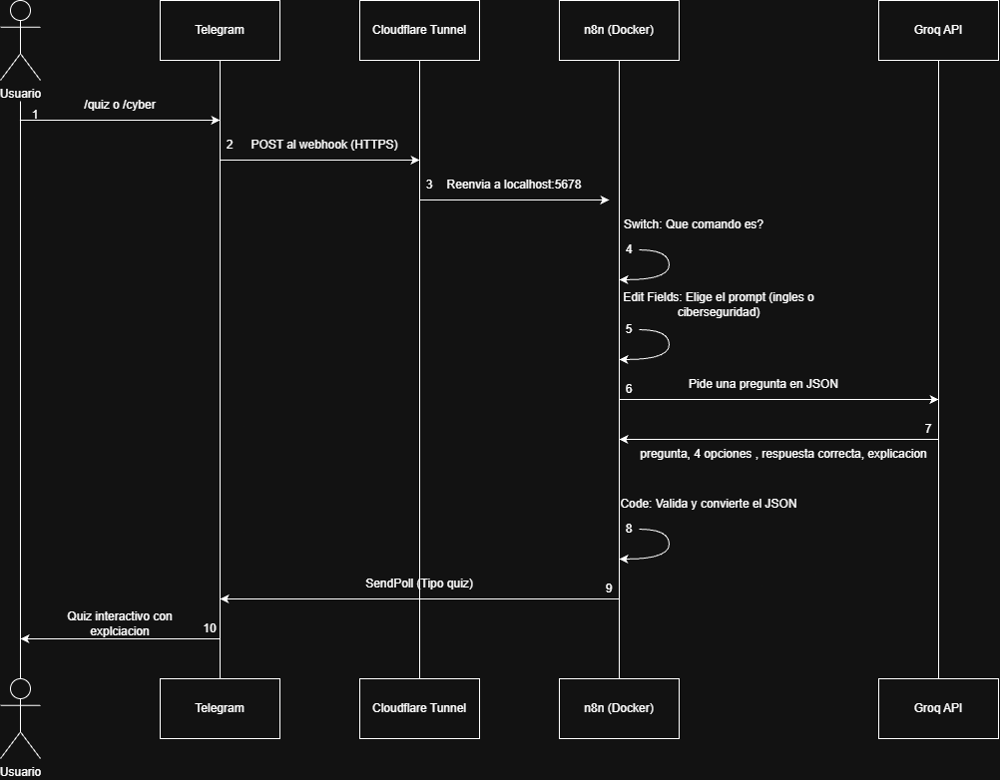
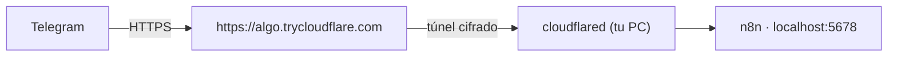
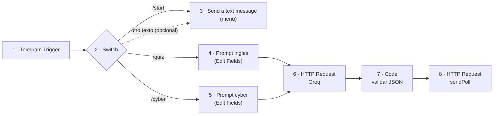
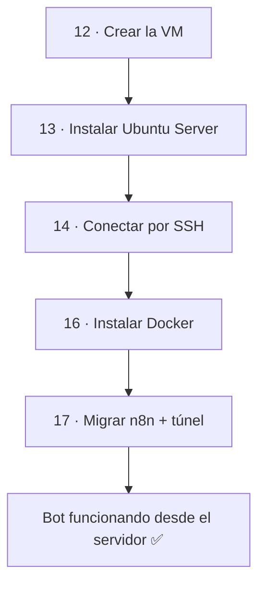

<div align="center">

#  TriviaDudeBot

### Un bot de trivia en Telegram con menú de comandos

Construido con **n8n**, **Groq** y **Docker**, y desplegado en un **Ubuntu Server** que corre en una VM.

<div align="center">
  <a href="https://n8n.io/">
    
  </a>
  <a href="https://www.docker.com/">
    
  </a>
  <a href="https://web.telegram.org/k/">
    
  </a>
  <a href="https://groq.com/">
    
  </a>
  <a href="https://ubuntu.com/download/server">
    
  </a>
</div>


<sub> <i>Captura de portada: el menú de <code>/start</code> </i></sub>

</div>

---

##  Tabla de contenido

| # | Sección | Qué encontrarás |
|---|---------|-----------------|
| 1 | [¿Qué es TriviaDudeBot?](#que-es) | Los tres comandos y qué vas a aprender |
| 2 | [Arquitectura](#arquitectura) | Diagramas del flujo y de la infraestructura |
| 3 | [Conceptos clave](#conceptos) | Glosario para no perderte |
| 4 | [Requisitos](#requisitos) | Lo que necesitas antes de empezar |
| 5 | [Estructura del repositorio](#estructura) | Qué archivo hace qué |
| | **PARTE I · Desarrollo en Windows** | |
| 6 | [Instalar Docker Desktop](#docker-desktop) | WSL 2, instalación y verificación |
| 7 | [Descargar y ejecutar n8n](#n8n-pull) | `docker pull`, `docker run` y Docker Desktop |
| 8 | [Crear el bot (BotFather) y la API de Groq](#telegram-groq) | Token, menú de comandos, API key y modelo |
| 9 | [El túnel público (Cloudflare)](#tunel) | Por qué Telegram lo necesita y cómo abrirlo |
| 10 | [Pasar n8n a Docker Compose](#compose-windows) | `WEBHOOK_URL`, respaldo y migración del contenedor |
| 11 | [Construir el workflow de TriviaDudeBot](#workflow) | Trigger, Switch, menú, prompts, Groq, Code y quiz |
| | **PARTE II · Producción en Ubuntu Server** | |
| 12 | [Crear la VM en VirtualBox](#vm) | Hardware, disco y red |
| 13 | [Instalar Ubuntu Server](#ubuntu) | Instalador paso a paso |
| 14 | [Conectarte por SSH](#ssh) | IP, `ssh`, y alternativa con NAT |
| 15 | [Rendimiento de la VM](#rendimiento) | Qué hacer si va lenta |
| 16 | [Instalar Docker en Ubuntu](#docker-ubuntu) | Cada comando explicado |
| 17 | [Migrar n8n al servidor](#migracion) | `scp`, permisos, compose, túnel y publicación |
| 18 | [Operación diaria: cuando cambia la URL del túnel](#operacion) | Servidor Linux y Windows, paso a paso |
| 19 | [Mantenimiento](#mantenimiento) | Disco, respaldos, IP fija |
| | **PARTE III · Cierre** | |
| 20 | [Trabajar con dos entornos (servidor ↔ Windows)](#dos-entornos) | Exportar, importar y no pelear por el webhook |
| 21 | [Seguridad y publicación en GitHub](#seguridad) | Qué NO subir y cómo exportar el workflow limpio |
| 22 | [Solución de problemas](#troubleshooting) | Errores reales y sus arreglos |
| 23 | [Hoja de ruta](#roadmap) | Ideas para seguir mejorándolo |
| 24 | [Checklist de capturas](#capturas) | Imágenes que debes agregar |
| 25 | [Licencia y autoría](#licencia) | |


<a id="que-es"></a>

## 1.  ¿Qué es TriviaDudeBot?

**TriviaDudeBot** es un bot de Telegram de trivia con un **menú de comandos**, parecido al que muestra BotFather cuando le escribes `/start`. Hoy responde a tres comandos:

| Comando | Qué hace |
|---------|----------|
| `/start` | Muestra el **menú** con los comandos disponibles (los comandos son tocables). |
| `/quiz` | Lanza una pregunta de opción múltiple de **inglés nivel B2** (marco CEFR) sobre un tema al azar: gramática, vocabulario, *phrasal verbs*, colocaciones, condicionales, estilo indirecto, expresiones idiomáticas o conectores. |
| `/cyber` | Lanza una pregunta de opción múltiple de **ciberseguridad estilo entrevista** (nivel junior-intermedio) sobre un tema al azar: redes, criptografía, OWASP Top 10, autenticación, malware, respuesta a incidentes, *hardening*, firewalls e IDS/IPS, nube, ingeniería social, gestión de vulnerabilidades o SIEM. |

Las preguntas llegan como **quiz nativo de Telegram**: tocas una opción, Telegram marca si acertaste y muestra una **explicación en español**.

### Cómo funciona, en pocas palabras

1. n8n recibe tu mensaje.
2. Un nodo **Switch** lee el comando y decide por cuál camino seguir.
3. Si es `/start`, responde con el menú. Si es `/quiz` o `/cyber`, prepara las instrucciones (el *prompt*) para la IA.
4. **Groq** genera la pregunta en formato JSON.
5. Un nodo **Code** valida que el JSON sea correcto.
6. n8n envía la pregunta a Telegram como quiz.

Las dos ramas de quiz **comparten los mismos nodos de Groq, Code y envío**: lo único que cambia entre ellas es el prompt.

### Aprendizajes

- Instalar **Docker Desktop** en Windows con **WSL 2** y ejecutar **n8n** en un contenedor.
- Crear un bot con **BotFather**, registrar su menú de comandos y consumir una **API de IA** (Groq) desde n8n.
- Entender por qué los **webhooks** necesitan una URL pública y resolverlo con un **túnel de Cloudflare**.
- Enrutar mensajes con un nodo **Switch** y reutilizar una misma cadena de nodos con **Edit Fields**.
- Validar con un nodo **Code** lo que devuelve una IA, para que nunca llegue un quiz roto.
- Crear un **servidor Ubuntu en VirtualBox**, manejarlo por **SSH** e instalar **Docker**.
- **Migrar** el sistema entre Windows y el servidor sin perder credenciales, y evitar que dos n8n se disputen el mismo bot.
---

<a id="arquitectura"></a>

## 2.  Arquitectura

### 2.1 Qué pasa cuando escribes `/quiz` o `/cyber`



Con `/start` el recorrido es más corto: el Switch envía directamente el mensaje del menú, sin pasar por Groq.

### 2.2 Dónde vive cada pieza


<a id="conceptos"></a>

## 3.  Conceptos clave

| Término | En palabras simples |
|---------|---------------------|
| **Docker** | Programa que ejecuta aplicaciones dentro de "cajas" aisladas llamadas contenedores. |
| **Imagen** | La "receta" empaquetada de una aplicación (por ejemplo `n8nio/n8n`). Se descarga con `docker pull`. |
| **Contenedor** | Una imagen en ejecución. Si lo borras, la app desaparece, pero **no** los datos guardados fuera de él. |
| **Volumen / bind mount** | Carpeta de tu PC conectada al interior del contenedor. Ahí vive tu información para que sobreviva. |
| **Docker Compose** | Archivo `docker-compose.yml` que describe un contenedor (imagen, puertos, variables, carpetas) para levantarlo con un solo comando. |
| **n8n** | Herramienta de automatización visual: conectas "nodos" para armar flujos. |
| **Nodo** | Cada bloque de un workflow (un disparador, un filtro, una llamada a una API…). |
| **Telegram Trigger** | Nodo que arranca el workflow cuando alguien le escribe al bot. |
| **Switch** | Nodo que reparte el flujo por **varias salidas** según una regla (aquí, según el comando). Un **IF** solo tiene dos: verdadero o falso. |
| **Edit Fields (Set)** | Nodo que guarda un dato con un nombre para que los siguientes lo usen (aquí, el prompt). |
| **Expresión (`fx`)** | Texto con `{{ ... }}` que n8n **calcula** en vez de tomarlo literal. En modo *Fixed*, el mismo texto se usa tal cual y no se calcula. |
| **Webhook** | Dirección web a la que un servicio (Telegram) envía un aviso cuando ocurre algo (un mensaje nuevo). |
| **Túnel (Cloudflare)** | Conexión que le da a tu n8n local una dirección pública HTTPS, para que Telegram pueda alcanzarlo. |
| **WSL 2** | Linux integrado en Windows. Docker Desktop lo usa como motor. |
| **VirtualBox** | Programa que crea computadores virtuales (VM) dentro de tu PC. |
| **Ubuntu Server** | Sistema operativo Linux sin interfaz gráfica, ideal para servidores. |
| **SSH** | Forma segura de controlar otro equipo escribiendo comandos desde tu terminal. |
| **Groq** | Servicio que ejecuta modelos de IA muy rápido mediante una API. |
| **`.env`** | Archivo con valores privados o específicos de tu entorno. **Nunca** se sube a GitHub. |

---

<a id="requisitos"></a>

## 4. ✅ Requisitos

| Necesitas | Para qué | Dónde |
|-----------|----------|-------|
| PC con **Windows 11** (64 bits) | Entorno de desarrollo y anfitrión de la VM | — |
| **Virtualización activada** en BIOS/UEFI | Docker Desktop y VirtualBox la necesitan | Se revisa en el Administrador de tareas |
| **16 GB de RAM** recomendados (8 GB mínimo) | Docker + VM funcionando a la vez | — |
| ~40 GB de disco libres | Imágenes de Docker + disco de la VM | — |
| Cuenta de **Telegram** | Crear y probar el bot | telegram.org |
| Cuenta de **Groq** | API key del modelo de IA | console.groq.com |
| **Docker Desktop** | Ejecutar n8n en Windows | docker.com |
| **VirtualBox** | Crear el servidor virtual | virtualbox.org |
| **ISO de Ubuntu Server** | Instalar el sistema del servidor | ubuntu.com/download/server |
| **cloudflared** | Túnel público | Se instala con `winget` (Windows) o `.deb` (Ubuntu) |
| **Git** y cuenta de **GitHub** | Versionar y publicar el proyecto | `winget install Git.Git` · github.com |
| **VS Code** (recomendado) | Editar el compose y limpiar el JSON del workflow | code.visualstudio.com |

---

<a id="estructura"></a>

## 5. 🗂️ Estructura del repositorio

```text
triviadudebot/
├── README.md              ← esta guía
├── docker-compose.yml     ← define el contenedor de n8n
├── .env.example           ← plantilla de variables (cópiala como .env)
├── .gitignore             ← evita subir secretos y datos de n8n
├── workflows/
│   └── triviadudebot.json ← el workflow exportado y LIMPIO (sin token)
└── docs/
    └── images/            ← capturas usadas en este README
```

> [!WARNING]
> Estos archivos **no** deben existir en el repositorio: `.env`, la carpeta de datos de n8n (`n8n-data/` o `n8n/`, que contiene la base de datos y la clave de cifrado), ni cualquier exportación del workflow que aún tenga el token (`*_RAW.json`). La [sección 21](#seguridad) explica cómo verificarlo.

---

# PARTE I · Desarrollo en Windows

<a id="docker-desktop"></a>

## 6. 🐳 Instalar Docker Desktop

Docker Desktop en Windows usa **WSL 2** (Linux dentro de Windows) como motor. Por eso, primero se prepara WSL y después se instala Docker Desktop.

### 6.1 Comprobar que la virtualización está activa

1. Abre el **Administrador de tareas** (`Ctrl + Shift + Esc`).
2. Ve a **Rendimiento → CPU**.
3. Abajo a la derecha debe decir **Virtualización: Habilitado**.

Si dice *Deshabilitado*, entra a la BIOS/UEFI de tu equipo y activa **Intel VT-x** (procesadores Intel) o **AMD SVM** (procesadores AMD).

### 6.2 Instalar o actualizar WSL 2

Abre **PowerShell como administrador** (clic derecho → *Ejecutar como administrador*):

```powershell
wsl --install
wsl --update
```

| Comando | Qué hace |
|---------|----------|
| `wsl --install` | Activa las características de Windows necesarias e instala WSL 2 con una distribución de Linux. |
| `wsl --update` | Actualiza el kernel de Linux que usa WSL a su versión más reciente. |

**Reinicia el PC** y comprueba:

```powershell
wsl --version
```

Debe mostrarte las versiones de WSL y del kernel **sin quedarse colgado y sin errores**.

<p align="center">
  <br>
  <sub><b>Figura 1.</b> Salida correcta de <code>wsl --version</code>.</sub>
</p>

> [!TIP]
> Si `wsl --version` se cuelga o da errores como `CommandTimedOut` o `REGDB_E_CLASSNOTREG`, ve a [Errores de WSL](#err-wsl) en la sección de solución de problemas antes de continuar.

### 6.3 Instalar Docker Desktop

1. Descarga el instalador desde la web oficial de Docker (*Docker Desktop for Windows*).
2. Ejecuta `Docker Desktop Installer.exe`.
3. Deja marcada la opción **Use WSL 2 instead of Hyper-V** y pulsa **OK/Install**.
4. Al terminar, **reinicia** Windows si te lo pide.
5. Abre Docker Desktop, acepta los términos y espera a que abajo a la izquierda indique que el motor está en ejecución (*Engine running*).

<p align="center">
  <br>
  <sub><b>Figura 2.</b> Instalador de Docker Desktop con la opción de WSL 2 activada.</sub>
</p>

Comprueba en **Settings → General** que esté activada la casilla **Use the WSL 2 based engine**.

<p align="center">
  <br>
  <sub><b>Figura 3.</b> Motor basado en WSL 2 activado en Docker Desktop.</sub>
</p>

### 6.4 Verificar la instalación

En PowerShell:

```powershell
docker --version
docker run hello-world
```

| Comando | Qué hace |
|---------|----------|
| `docker --version` | Muestra la versión instalada; confirma que el cliente funciona. |
| `docker run hello-world` | Descarga una imagen mínima de prueba y la ejecuta. Si ves *"Hello from Docker!"*, todo el sistema funciona. |

---

<a id="n8n-pull"></a>

## 7. ⚙️ Descargar (`pull`) y ejecutar n8n

### 7.1 Imagen vs. contenedor

- La **imagen** `n8nio/n8n` es el paquete oficial de n8n publicado en Docker Hub. Se descarga **una vez**.
- El **contenedor** es esa imagen funcionando. Puedes crearlo, detenerlo y borrarlo sin tocar la imagen.

### 7.2 Opción A: desde la terminal

**Paso 1 · Descargar la imagen**

```powershell
docker pull n8nio/n8n:latest
```

Descarga la última versión de n8n desde Docker Hub. (Esta guía se probó con **n8n 2.48.6**. Si quieres reproducibilidad exacta, puedes reemplazar `latest` por un número de versión concreto; los tags disponibles están en Docker Hub).

**Paso 2 · Ejecutar el contenedor**

```powershell
docker run -d --name n8n_local -p 5678:5678 -v C:\Users\TU_USUARIO\n8n:/home/node/.n8n n8nio/n8n:latest
```

| Parte del comando | Significado |
|-------------------|-------------|
| `docker run` | Crea y arranca un contenedor nuevo. |
| `-d` | *Detached*: corre en segundo plano y te devuelve la terminal. |
| `--name n8n_local` | Le pone un nombre fácil de recordar. |
| `-p 5678:5678` | Conecta el puerto **5678 de tu PC** con el **5678 del contenedor** (el puerto de n8n). Por eso abres `http://localhost:5678`. |
| `-v C:\Users\TU_USUARIO\n8n:/home/node/.n8n` | Conecta una carpeta de tu PC con la carpeta interna donde n8n guarda **todo**: base de datos, credenciales cifradas y su clave de cifrado. Si Docker no encuentra la carpeta, la crea. |
| `n8nio/n8n:latest` | La imagen que se va a ejecutar. |

> [!IMPORTANT]
> El parámetro `-v` es lo que **protege tu trabajo**. Sin él, al borrar el contenedor perderías todos tus workflows y credenciales.

### 7.3 Opción B: desde la interfaz de Docker Desktop

1. Ve a **Images** → busca `n8nio/n8n` en la barra de búsqueda → **Pull**.
2. Cuando termine, pulsa el botón **▶ Run** de esa imagen.
3. Abre **Optional settings** y rellena:
   - **Container name:** `n8n_local`
   - **Host port:** `5678`
   - **Volumes → Host path:** `C:\Users\TU_USUARIO\n8n` → **Container path:** `/home/node/.n8n`
4. Pulsa **Run**.

<p align="center">
  <br>
  <sub><b>Figura 4.</b> Descarga (<i>pull</i>) de la imagen <code>n8nio/n8n</code>.</sub>
</p>

<p align="center">
  <br>
  <sub><b>Figura 5.</b> Opciones del contenedor: nombre, puerto y carpeta de datos.</sub>
</p>

> [!NOTE]
> Crear el contenedor desde Docker Desktop **no genera ningún `docker-compose.yml`**. En la [sección 10](#compose-windows) verás cómo pasar a Compose sin perder datos.

### 7.4 Primer acceso a n8n

1. Abre **http://localhost:5678** en tu navegador.
2. n8n te pide crear la cuenta del propietario (correo, nombre y contraseña). Es local, solo para ti.
3. Ya puedes ver el editor vacío.

<p align="center">
  <br>
  <sub><b>Figura 6.</b> Primer acceso: creación de la cuenta del propietario de n8n.</sub>
</p>

### 7.5 Comandos útiles para manejar el contenedor

| Comando | Para qué sirve |
|---------|----------------|
| `docker ps` | Lista los contenedores **en ejecución**. |
| `docker ps -a` | Lista todos, también los detenidos. |
| `docker logs -f n8n_local` | Muestra los registros en vivo (`Ctrl+C` para salir). |
| `docker stop n8n_local` | Detiene el contenedor. |
| `docker start n8n_local` | Lo vuelve a arrancar. |
| `docker restart n8n_local` | Lo reinicia. |
| `docker rm n8n_local` | Borra el contenedor (**no** borra tu carpeta de datos). |

---

<a id="telegram-groq"></a>

## 8. 🔑 Crear el bot (BotFather) y la API de Groq

### 8.1 Crear el bot en Telegram con BotFather

**BotFather** es el bot oficial de Telegram para crear y administrar bots. Si le escribes `/start`, te muestra justo el tipo de menú que vas a construir para tu propio bot: una lista de comandos tocables.

1. En Telegram, busca **@BotFather** (el que tiene la insignia de verificación azul) y ábrelo.
2. Envía el comando:
   ```text
   /newbot
   ```
3. **Nombre del bot** (el que se muestra en el chat): `TriviaDudeBot`.
4. **Username** (debe ser único y **terminar en `bot`**): por ejemplo `TriviaDudeBot`. Si está ocupado, prueba una variante (`TriviaDude_bot`, `MiTriviaDudeBot`…).
5. BotFather te responde con el **token**, algo como `123456789:AAH...`. **Guárdalo**: es la contraseña de tu bot.

<p align="center">
  <br>
  <sub><b>Figura 7.</b> Creación del bot con <code>/newbot</code>. (Tapa el token en la captura).</sub>
</p>

> [!CAUTION]
> **Quien tenga tu token controla tu bot.** No lo pegues en capturas, repositorios ni chats. Si se filtra, envía `/revoke` a BotFather para generar uno nuevo.

Comandos de BotFather que conviene conocer:

| Comando | Qué hace |
|---------|----------|
| `/setdescription` | Texto que se muestra cuando alguien abre el bot por primera vez. |
| `/setabouttext` | Texto corto del perfil del bot. |
| `/setuserpic` | Foto de perfil del bot. |
| `/setcommands` | Registra el **menú de comandos** del bot (ver 8.2). |
| `/token` | Muestra el token actual del bot. |
| `/revoke` | Genera un token nuevo e invalida el anterior. |
| `/deletebot` | Elimina el bot. |

**Importante:** abre tu bot en Telegram y envíale cualquier mensaje (por ejemplo `hola`). Un bot solo puede escribirte después de que tú le hayas escrito primero.

### 8.2 Registrar el menú de comandos (`/setcommands`)

Este paso es **opcional pero recomendado**: hace que Telegram muestre una lista de sugerencias al escribir `/` y un botón de menú junto al campo de texto.

1. Envía `/setcommands` a BotFather y elige tu bot.
2. Responde con **una línea por comando**, sin la barra `/` y con un guion que separa el nombre de la descripción:

```text
start - Ver el menú de comandos
quiz - Pregunta de inglés nivel B2
cyber - Pregunta de ciberseguridad de entrevista
```

<p align="center">
  <br>
  <sub><b>Figura 8.</b> Registro del menú de comandos con <code>/setcommands</code>.</sub>
</p>

> [!NOTE]
> Esto solo registra el menú **visual** de Telegram. Lo que de verdad hace que cada comando funcione es el workflow de n8n (sección 11). Y el mensaje que responde a `/start` (el menú dentro del chat) también lo construye el workflow.

### 8.3 Obtener tu `chat_id` (opcional)

TriviaDudeBot responde a **cualquier persona** que le escriba y lee el `chat_id` del propio mensaje, así que **no necesitas** conocerlo para que funcione. Lo necesitarías solo si quieres **restringir el bot a tu cuenta** (por ejemplo, con un IF antes del Switch).

Cuando el bot ya tiene un webhook activo, el método clásico `getUpdates` **no funciona** (Telegram responde con un conflicto). Para ver tu `chat_id`:

1. En n8n, abre el **Telegram Trigger** y pulsa **Listen for test event**.
2. Escríbele un mensaje al bot.
3. En el panel **Output** del trigger, despliega `message → chat → id`. Ese número es tu `chat_id`.

También puedes mirarlo en la pestaña **Executions** del workflow, abriendo una ejecución pasada y haciendo clic en el Telegram Trigger.

### 8.4 Obtener la API key de Groq

1. Entra a **console.groq.com** e inicia sesión.
2. Ve a **API Keys → Create API Key**.
3. Ponle un nombre (por ejemplo `triviadudebot`) y **copia la clave**: solo se muestra una vez.

<p align="center">
  <br>
  <sub><b>Figura 9.</b> Creación de la API key en Groq. (Oculta la clave en la captura).</sub>
</p>

### 8.5 Elegir el modelo

En la documentación de Groq (`console.groq.com/docs/models`) hay una tabla de **Production Models**. Al construir este proyecto, los modelos **Llama 3.1 8B** y **Llama 3.3 70B** aparecían marcados como **Enterprise** ("Contact Sales"), es decir, **no disponibles en el plan Developer**. Usarlos devuelve este error:

```text
404 - The model `llama-3.3-70b-versatile` does not exist or you do not have access to it. (model_not_found)
```

Los que sí tenían límites y precio para el plan Developer eran:

| Modelo (ID exacto) | Cuándo usarlo |
|--------------------|---------------|
| `openai/gpt-oss-120b` | **Recomendado.** Más capaz: genera preguntas con una sola respuesta correcta y explicaciones fiables. |
| `openai/gpt-oss-20b` | Más rápido y barato; sirve para preguntas más simples. |

> [!TIP]
> Los modelos cambian con el tiempo. Para ver cuáles tiene **tu cuenta**:
> ```powershell
> curl.exe https://api.groq.com/openai/v1/models -H "Authorization: Bearer TU_API_KEY_DE_GROQ"
> ```
> Ignora los modelos de audio (`whisper...`) y de moderación; elige uno de chat tipo *instruct* y copia su `id` tal cual. También puedes mirar **Settings → Limits** en la consola.

---

<a id="tunel"></a>

## 9. ☁️ El túnel público (Cloudflare)

### 9.1 El problema

El **Telegram Trigger** de n8n funciona con un **webhook**: cuando alguien escribe al bot, los servidores de Telegram envían un aviso a una URL tuya. Pero Telegram **solo acepta direcciones públicas con HTTPS**, y tu n8n es `http://localhost:5678`, que solo existe dentro de tu PC.

### 9.2 La solución

**cloudflared** abre una conexión **de salida** desde tu equipo hacia Cloudflare, y Cloudflare te da una dirección pública HTTPS que reenvía todo a tu n8n. No tienes que abrir puertos del router ni cambiar nada del firewall.



### 9.3 Instalar y abrir el túnel en Windows

```powershell
winget install Cloudflare.cloudflared
```

Cierra y vuelve a abrir PowerShell (para que Windows reconozca el comando) y verifica:

```powershell
cloudflared --version
```

Abre el túnel:

```powershell
cloudflared tunnel --url http://localhost:5678
```

| Parte | Significado |
|-------|-------------|
| `cloudflared tunnel` | Inicia un túnel. |
| `--url http://localhost:5678` | A qué servicio local debe reenviar el tráfico (tu n8n). |

Tras unos segundos verás un recuadro con tu URL pública:

```text
Your quick Tunnel has been created! Visit it at:
https://palabra-palabra-palabra.trycloudflare.com
```

<p align="center">
  <br>
  <sub><b>Figura 10.</b> Túnel abierto: <code>cloudflared</code> entrega la URL pública.</sub>
</p>

**Cópiala y comprueba** que funciona abriéndola en el navegador: debe aparecer tu n8n.

<p align="center">
  <br>
  <sub><b>Figura 11.</b> n8n accesible desde la URL pública del túnel.</sub>
</p>

> [!WARNING]
> - **Deja esa ventana de PowerShell abierta.** Si la cierras (o pulsas `Ctrl+C`), el túnel se apaga y el bot deja de recibir mensajes.
> - La URL **cambia cada vez** que reinicias el túnel (ver [sección 18](#operacion)).
> - Cualquiera con la URL puede ver tu pantalla de login de n8n (sigue protegida por tu usuario y contraseña). No la compartas.
> - Si ves **502 Bad Gateway**: el túnel funciona, pero n8n no está corriendo en el puerto 5678.

> [!NOTE]
> **¿Aparece *"it may take some time to be reachable"*?** Un dominio recién creado puede tardar uno o dos minutos en ser visible desde fuera de tu PC. Si Telegram responde `Failed to resolve host`, no es un error de tu configuración: espera un poco y reintenta (ver [18.5](#operacion)).

---

<a id="compose-windows"></a>

## 10. 📦 Pasar n8n a Docker Compose (`WEBHOOK_URL`)

Para que n8n **registre correctamente el webhook** en Telegram, debe conocer su dirección pública. Eso se hace con la variable **`WEBHOOK_URL`**. La forma ordenada de manejarla es con un `docker-compose.yml`.

> [!NOTE]
> En n8n 2.x los registros muestran un aviso recomendando el nombre `N8N_WEBHOOK_URL` en lugar de `WEBHOOK_URL`. Con la versión probada (2.48.6) **`WEBHOOK_URL` sigue funcionando**, y es la que usa esta guía.

### 10.1 Las dos carpetas: datos y configuración

Al terminar esta sección tendrás **dos carpetas distintas** en tu PC. Es normal, y conviene tener claro qué hace cada una:

| Carpeta | Qué contiene | ¿La tocas? |
|---------|--------------|------------|
| `C:\Users\TU_USUARIO\n8n` | Los **datos** de n8n: `database.sqlite` (tus workflows, credenciales e historial), `config` (la clave de cifrado), y las carpetas `nodes` y `storage`. | **No**, nunca a mano. |
| `C:\Users\TU_USUARIO\n8n-docker` | La **configuración del contenedor**: el `docker-compose.yml`. | Solo para cambiar variables como `WEBHOOK_URL`. |

Tu workflow **está dentro de `database.sqlite`**. No hay un archivo del workflow que buscar: se edita desde el navegador, en `http://localhost:5678`.

### 10.2 Respaldo antes de tocar nada

**a) Averigua dónde están tus datos.** Si creaste el contenedor desde Docker Desktop, confírmalo:

```powershell
docker inspect n8n_local --format "{{ json .Mounts }}"
```

Debe aparecer algo como `"Source":"C:\\Users\\TU_USUARIO\\n8n","Destination":"/home/node/.n8n"`. Esa es tu carpeta de datos.

**b) Detén el contenedor y copia la carpeta** (detenerlo antes evita copiar la base de datos a medias):

```powershell
docker stop n8n_local
Copy-Item -Recurse C:\Users\TU_USUARIO\n8n C:\Users\TU_USUARIO\n8n_backup
```

**c) Confirma que existe el archivo de la clave de cifrado:**

```powershell
Test-Path C:\Users\TU_USUARIO\n8n\config
```

Debe responder `True`. Ese archivo `config` contiene la **clave que cifra tus credenciales**.

> [!CAUTION]
> **No definas `N8N_ENCRYPTION_KEY` si no la tenías desde el principio.** n8n generó una clave automática y la guardó en `config`. Si ahora pones otra distinta, tus credenciales (Groq, Telegram) dejarán de poder descifrarse.

### 10.3 Los archivos del proyecto

Crea la carpeta `C:\Users\TU_USUARIO\n8n-docker` (**aparte de los datos de n8n**) con estos archivos.

**`docker-compose.yml`**

```yaml
services:
  n8n:
    image: n8nio/n8n:latest
    container_name: n8n_local
    restart: unless-stopped
    ports:
      - "5678:5678"
    environment:
      - GENERIC_TIMEZONE=America/Bogota
      - TZ=America/Bogota
      - WEBHOOK_URL=${WEBHOOK_URL:?Define WEBHOOK_URL en el archivo .env}
      - N8N_SECURE_COOKIE=false
    volumes:
      - ${N8N_DATA_DIR:?Define N8N_DATA_DIR en el archivo .env}:/home/node/.n8n
```

**`.env`** (este archivo **no se sube** a GitHub; en el repositorio va `.env.example`)

```dotenv
WEBHOOK_URL=https://palabra-palabra-palabra.trycloudflare.com/
N8N_DATA_DIR=C:/Users/TU_USUARIO/n8n
```

| Línea | Para qué sirve |
|-------|----------------|
| `image: n8nio/n8n:latest` | La misma imagen que ya descargaste. |
| `container_name: n8n_local` | Mantiene el nombre del contenedor. |
| `restart: unless-stopped` | El contenedor arranca solo cuando Docker arranca (útil en el servidor). |
| `ports: "5678:5678"` | Mismo mapeo de puertos que antes. |
| `GENERIC_TIMEZONE` / `TZ` | Zona horaria de Bogotá, para que los horarios de n8n sean correctos. |
| `WEBHOOK_URL` | **La clave de este paso**: la URL pública del túnel (con `https://` y **terminada en `/`**). |
| `N8N_SECURE_COOKIE=false` | Permite iniciar sesión entrando por `http://` desde otro equipo de tu red local (por ejemplo `http://IP_DEL_SERVIDOR:5678`). Quítala si algún día usas HTTPS propio. |
| `${WEBHOOK_URL:?...}` | Toma el valor del `.env`; si falta, Compose se detiene con un mensaje claro en vez de arrancar mal. |
| `volumes: ...:/home/node/.n8n` | **Tu misma carpeta de datos** conectada al contenedor. |

> [!NOTE]
> **Dos formas de escribir la URL.** En esta guía el compose lee `WEBHOOK_URL` desde un archivo `.env`. También es válido escribirla directamente en el compose, como `- WEBHOOK_URL=https://...trycloudflare.com/`. Cualquiera de las dos funciona; lo importante es saber **cuál tienes tú**, porque es el archivo que debes editar cuando cambie el túnel (ver [sección 18](#operacion)).

### 10.4 Reemplazar el contenedor

El contenedor antiguo ya está detenido. Bórralo (esto **no** borra tu carpeta de datos) y levanta el nuevo con Compose:

```powershell
docker rm n8n_local
cd C:\Users\TU_USUARIO\n8n-docker
docker compose up -d
```

| Comando | Qué hace |
|---------|----------|
| `docker rm n8n_local` | Elimina solo el contenedor viejo, para liberar el nombre. |
| `cd ...` | Entra a la carpeta donde está el `docker-compose.yml`. |
| `docker compose up -d` | Lee el compose y el `.env`, crea el contenedor y lo deja corriendo en segundo plano. Si ya existe y **no cambió nada**, dice `Running`; si cambiaste una variable, lo **recrea** (`Recreated`/`Started`). |
| `docker compose up -d --force-recreate` | Fuerza que lo recree **siempre**. Útil cuando dudas de si tomó los cambios. |

> [!CAUTION]
> **Nunca uses `docker compose down -v`**: la opción `-v` elimina volúmenes y podrías perder datos.

### 10.5 ¿Por qué Docker Desktop muestra "dos contenedores"?

Después de usar Compose verás en Docker Desktop una fila `n8n-docker` y, debajo, otra `n8n_local`. **No son dos contenedores**: la primera es el **grupo** (Docker Compose agrupa los contenedores de un proyecto bajo el nombre de la carpeta donde está el `docker-compose.yml`), y la segunda es tu único contenedor de n8n, con su imagen y su puerto.

Cada vez que ejecutas `docker compose up -d` con una variable cambiada, el contenedor se **recrea** y su ID (la columna que se ve en Docker Desktop) cambia. Tus datos no se tocan porque viven en la carpeta `n8n`.

<p align="center">
  <br>
  <sub><b>Figura 12.</b> El grupo <code>n8n-docker</code> (la carpeta del compose) y, debajo, el único contenedor <code>n8n_local</code>.</sub>
</p>

### 10.6 Verificar

```powershell
docker compose exec n8n printenv WEBHOOK_URL
```

Debe imprimir la URL de tu túnel. Después abre `http://localhost:5678` y confirma que tus workflows y credenciales siguen ahí.

**Plan de vuelta** si algo sale mal (tienes tu respaldo y tu carpeta intacta):

```powershell
docker compose down
docker run -d --name n8n_local -p 5678:5678 -v C:\Users\TU_USUARIO\n8n:/home/node/.n8n n8nio/n8n:latest
```

---

<a id="workflow"></a>

## 11. 🧩 Construir el workflow de TriviaDudeBot

### 11.0 La idea antes de los clics

Hay tres comandos y cada uno debe hacer algo distinto. Para repartirlos se usa un nodo **Switch**:

| Nodo | Salidas | Cuándo usarlo |
|------|---------|---------------|
| **IF** | 2 (verdadero / falso) | Cuando solo hay una pregunta de sí o no. |
| **Switch** | Una por cada regla (3, 4, 5…) | Cuando hay varios caminos posibles, como aquí: `/start`, `/quiz` y `/cyber`. |

Y para no repetir nodos, las dos ramas de quiz **comparten la misma cadena** (Groq → Code → envío del quiz). Cada rama solo deja antes un "papelito" con las instrucciones para la IA, y Groq lo lee:



<p align="center">
  <br>
  <sub><b>Figura 13.</b> Workflow completo de TriviaDudeBot: trigger, Switch, menú, prompts, Groq, Code y <code>sendPoll</code>.</sub>
</p>

> [!TIP]
> Si tienes un workflow anterior con la cadena Groq → Code → `sendPoll`, puedes **reciclarla**: selecciona solo esos nodos, cópialos con `Ctrl+C` y pégalos con `Ctrl+V` en el workflow nuevo. **No copies el Telegram Trigger viejo**: apunta a otro bot. Después revisa el token del paso 8 (`sendPoll`).

### 11.1 Crear las credenciales

En n8n: **Credentials → Create credential** (o desde dentro de cada nodo).

**Credencial de Groq (Header Auth)**

| Campo | Valor |
|-------|-------|
| Tipo | **Header Auth** |
| Name | `Authorization` |
| Value | `Bearer TU_API_KEY_DE_GROQ` (la palabra `Bearer`, un espacio y la clave) |

<p align="center">
  <br>
  <sub><b>Figura 14.</b> Credencial de Groq (oculta el valor en la captura).</sub>
</p>

**Credencial de Telegram**

| Campo | Valor |
|-------|-------|
| Tipo | **Telegram API** |
| Access Token | El token que te dio BotFather para **TriviaDudeBot** |

<p align="center">
  <br>
  <sub><b>Figura 15.</b> Credencial de Telegram (oculta el token en la captura).</sub>
</p>

> [!TIP]
> Guardar las claves como **credenciales** (y no escritas dentro de un nodo) evita que viajen dentro del workflow exportado.

### 11.2 Nodo 1 · Telegram Trigger

Es el **disparador**: se activa cada vez que alguien escribe al bot.

1. Haz clic en **+** (*Add first step*) y busca **Telegram Trigger** → **On message**.
2. **Credential:** elige la credencial de Telegram de TriviaDudeBot.
3. **Updates:** `message`.
4. Déjalo con el nombre **`Telegram Trigger`**: otros nodos lo referencian por ese nombre.

<p align="center">
  <br>
  <sub><b>Figura 16.</b> Nodo Telegram Trigger.</sub>
</p>

> [!NOTE]
> Este nodo **requiere** el túnel y `WEBHOOK_URL` de las secciones 9 y 10. Si no, n8n mostrará un error pidiendo una URL HTTPS, o *"bad webhook: Failed to resolve host"*.

### 11.3 Nodo 2 · Switch (el repartidor de comandos)

1. Agrega un **Switch** después del trigger. **Mode:** *Rules*.
2. Crea **3 reglas** (*Add Routing Rule*). En **todas**, *Value 1* es esta expresión y el operador es **String → is equal to**:

```text
{{ ($json.message.text || '').trim().toLowerCase().split(/[\s@]/)[0] }}
```

| Regla | Value 2 | Renombrar salida a |
|-------|---------|--------------------|
| 1 | `/start` | `start` |
| 2 | `/quiz` | `quiz` |
| 3 | `/cyber` | `cyber` |

3. Activa **Rename Output** en cada regla y escribe el nombre de la tabla, para identificar las salidas en el lienzo.

<p align="center">
  <br>
  <sub><b>Figura 17.</b> Nodo Switch con sus tres reglas y las salidas renombradas.</sub>
</p>

**Qué hace la expresión, por partes:**

| Parte | Para qué sirve |
|-------|----------------|
| `$json.message.text` | El texto que escribió el usuario. |
| `\|\| ''` | Si el mensaje no tiene texto (una foto, un sticker), usa un texto vacío en vez de dar error. |
| `.trim()` | Quita espacios al inicio y al final. |
| `.toLowerCase()` | Pasa a minúsculas, así `/QUIZ` también funciona. |
| `.split(/[\s@]/)[0]` | Se queda con lo que va **antes de un espacio o una `@`**. Así `/quiz@TriviaDudeBot` (como llega en los grupos) y `/quiz algo` se reconocen como `/quiz`. |

> [!WARNING]
> **El error más común de este nodo: el campo en modo *Fixed*.** Si pegas la expresión y el campo queda en modo fijo, n8n la trata como **texto literal** y nunca coincide con ningún comando: el flujo se detiene **sin mostrar ningún error** y el bot parece mudo. Reconocerlo es fácil: un campo en modo *Expression* muestra el icono **`fx`** a la izquierda y el texto resaltado en **verde**. Si no lo ves, pasa el mouse sobre el campo y cambia **Fixed** por **Expression**.

<p align="center">
  <br>
  <sub><b>Figura 18.</b> Una regla en modo <i>Expression</i> (icono <code>fx</code>, texto verde) frente a otra en modo <i>Fixed</i>.</sub>
</p>

**Salida de respaldo (opcional, recomendada).** En el Switch, **Options → Fallback Output → Extra Output**. Conecta esa salida extra al **mismo** nodo del menú (el del paso siguiente): así, cuando alguien escribe algo que no es un comando, el bot le muestra el menú en lugar de quedarse callado.

### 11.4 Nodo 3 · Send a text message (el menú de `/start`)

Conecta la salida **start** a un nodo **Telegram → Send a text message** (*Resource:* Message, *Operation:* Send Message):

| Campo | Valor |
|-------|-------|
| **Credential** | La de TriviaDudeBot |
| **Chat ID** | `{{ $('Telegram Trigger').first().json.message.chat.id }}` |
| **Text** | El menú (ver abajo) |

**Text:**

```text
👋 ¡Hola! Soy TriviaDudeBot.

Estos son mis comandos:

/quiz – Pregunta de inglés nivel B2
/cyber – Pregunta de ciberseguridad (entrevista)
/start – Mostrar este menú
```

Además, en **Add Field** busca **Append n8n Attribution** y **desactívalo**: viene activado por defecto y añade una línea de "enviado con n8n" al mensaje.

<p align="center">
  <br>
  <sub><b>Figura 19.</b> Nodo que envía el menú de <code>/start</code>.</sub>
</p>

> [!TIP]
> Telegram convierte automáticamente los `/comandos` de un texto en **enlaces tocables**, igual que hace BotFather. El usuario solo toca `/quiz` y se envía solo.

### 11.5 Nodos 4 y 5 · Edit Fields: el "papelito" con el prompt

Las salidas **quiz** y **cyber** del Switch van cada una a un nodo **Edit Fields (Set)**. Este nodo solo hace una cosa: guarda un texto con un nombre. Aquí, el nombre es **`systemPrompt`**, y es lo que el nodo de Groq va a leer.

```text
Switch ──► quiz  ──► [Edit Fields: prompt de inglés]  ──┐
       └─► cyber ──► [Edit Fields: prompt de cyber]   ──┴─► Groq (lee systemPrompt)
```

Para cada nodo: **Mode:** *Manual Mapping* → **Add Field** → **Name** `systemPrompt`, **Type** *String*, **Value** el texto de abajo. Renombra los nodos a **`Prompt inglés`** y **`Prompt cyber`**.

**Value de `Prompt inglés`:**

```text
You are an English teacher. Generate ONE multiple-choice question at CEFR B2 level. Topic: {{ ['grammar','vocabulary','phrasal verbs','collocations','conditionals','reported speech','idioms','linkers'].sort(() => Math.random() - 0.5)[0] }}. Return ONLY a JSON object with these keys: question (string, max 280 chars), options (array of exactly 4 strings, max 90 chars each), correct_index (integer 0-3), explanation (string, max 190 chars, in Spanish). Randomize the position of the correct answer.
```

<p align="center">
  <br>
  <sub><b>Figura 20.</b> Nodo <code>Prompt inglés</code>: campo <code>systemPrompt</code> y vista previa del resultado.</sub>
</p>

**Value de `Prompt cyber`:**

```text
You are a cybersecurity interviewer preparing a candidate for a junior-to-mid level security job interview (SOC analyst, pentester or security engineer). Generate ONE multiple-choice question about: {{ ['networking (TCP/IP, DNS, ports)','cryptography','OWASP Top 10','authentication and access control','malware','incident response','Linux and Windows hardening','firewalls and IDS/IPS','cloud security','social engineering','vulnerability management','SIEM and log analysis'].sort(() => Math.random() - 0.5)[0] }}. Write the question and options in English. It must be realistic for a job interview, with exactly one clearly correct answer and three plausible distractors. Return ONLY a JSON object with these keys: question (string, max 280 chars), options (array of exactly 4 strings, max 90 chars each), correct_index (integer 0-3), explanation (string, max 190 chars, in Spanish). Randomize the position of the correct answer.
```

<p align="center">
  <br>
  <sub><b>Figura 21.</b> Nodo <code>Prompt cyber</code>: campo <code>systemPrompt</code> y vista previa del resultado.</sub>
</p>

| Parte del prompt | Para qué sirve |
|------------------|----------------|
| Rol (*teacher* / *interviewer*) | Define el tipo de pregunta y su nivel. |
| `{{ [...].sort(() => Math.random() - 0.5)[0] }}` | Expresión de n8n que elige **un tema al azar** de la lista en cada ejecución. Para agregar temas, solo añade elementos a la lista: no hay que contar cuántos son. |
| `Return ONLY a JSON object with these keys...` | Fija el formato exacto de la respuesta y los **límites de longitud** que exige Telegram para los quizzes. |
| `in Spanish` (en `explanation`) | La explicación sale en español. Si quieres las preguntas de `/cyber` en español, cambia `Write the question and options in English`. |

> [!NOTE]
> El formato JSON se describe **con palabras** y no con llaves `{ }` a propósito: dentro de un campo de n8n, las llaves pueden confundirse con las expresiones `{{ }}`.

**Cómo comprobar que quedó bien:** el texto lleva `{{ ... }}`, así que debe estar en modo **Expression**. Si lo está, debajo del campo aparece una vista previa del **Resultado** con un tema ya elegido (por ejemplo `Topic: idioms.`). Si ves los corchetes y las llaves literales, cambia el campo de **Fixed** a **Expression**.

### 11.6 Nodo 6 · HTTP Request a Groq (compartido)

Conecta **las salidas de los dos nodos de prompt** a este único nodo. n8n permite varias conexiones entrantes al mismo nodo, y solo se ejecuta la rama que se activó.

| Campo | Valor |
|-------|-------|
| **Method** | `POST` |
| **URL** | `https://api.groq.com/openai/v1/chat/completions` |
| **Authentication** | *Generic Credential Type* → **Header Auth** → tu credencial de Groq |
| **Send Body** | Activado → *Body Content Type:* **JSON** → *Specify Body:* **Using JSON** |

**Body:**

```json
{
  "model": "openai/gpt-oss-120b",
  "temperature": 1,
  "reasoning_effort": "low",
  "response_format": { "type": "json_object" },
  "messages": [
    { "role": "system", "content": {{ JSON.stringify($json.systemPrompt) }} },
    { "role": "user", "content": "Give me a new question." }
  ]
}
```

| Parte del body | Para qué sirve |
|----------------|----------------|
| `model` | El modelo de Groq (ver [8.5](#telegram-groq)). |
| `temperature: 1` | Más variedad: no repite siempre las mismas preguntas. |
| `reasoning_effort: "low"` | Estos modelos "razonan" antes de responder; así lo hacen rápido y gastan menos tokens. Si Groq se queja de este parámetro, bórralo. |
| `response_format: json_object` | Pide que la respuesta sea JSON válido. Si diera error, quítalo: el prompt ya exige JSON y el nodo Code lo limpia. |
| `{{ JSON.stringify($json.systemPrompt) }}` | **La clave de la reutilización:** toma el campo `systemPrompt` que dejó el nodo anterior (inglés o cyber) y lo inserta de forma segura dentro del JSON. |

<p align="center">
  <br>
  <sub><b>Figura 22.</b> Nodo HTTP Request hacia Groq (compartido por <code>/quiz</code> y <code>/cyber</code>).</sub>
</p>

> [!NOTE]
> Si pulsas **Execute step** en este nodo solo, fallará, porque no llegó ningún `systemPrompt`. Pruébalo ejecutando todo el flujo desde el trigger.

### 11.7 Nodo 7 · Code (parsear y validar)

La respuesta de Groq llega como **texto** dentro de `choices[0].message.content`. Este nodo la convierte en datos utilizables y **comprueba que sean correctos** antes de enviarlos.

**Configuración:** *Mode:* **Run Once for All Items**, *Language:* JavaScript.

````javascript
const raw = $input.first().json.choices[0].message.content
  .replace(/```json|```/g, '')
  .trim();

const q = JSON.parse(raw);

// Validaciones para evitar quizzes rotos
if (!Array.isArray(q.options) || q.options.length !== 4) {
  throw new Error('La IA no devolvió 4 opciones');
}
if (!Number.isInteger(q.correct_index) || q.correct_index < 0 || q.correct_index > 3) {
  throw new Error('correct_index inválido');
}

return [{ json: q }];
````

| Línea | Qué hace |
|-------|----------|
| `$input.first().json.choices[0].message.content` | Toma el texto que generó la IA. |
| ``.replace(/```json\|```/g, '')`` | Quita las marcas de código (tres tildes invertidas) que algunos modelos agregan alrededor del JSON. |
| `.trim()` | Elimina espacios y saltos de línea sobrantes. |
| `JSON.parse(raw)` | Convierte el texto en un objeto con `question`, `options`, `correct_index` y `explanation`. |
| Los dos `if` con `throw new Error` | Garantizan que haya **exactamente 4 opciones** y que `correct_index` sea un entero entre 0 y 3. Si no, el flujo falla con un mensaje claro en lugar de mandar un quiz roto. |
| `return [{ json: q }]` | Entrega el objeto al siguiente nodo. |

<p align="center">
  <br>
  <sub><b>Figura 23.</b> Nodo Code y su salida (<code>question</code>, <code>options</code>, <code>correct_index</code>, <code>explanation</code>).</sub>
</p>

<details>
<summary><b>🐍 ¿Se puede escribir este nodo en Python?</b></summary>

<br>

La traducción es directa:

````python
import json
import re

raw = _items[0]["json"]["choices"][0]["message"]["content"]
raw = re.sub(r"```json|```", "", raw).strip()

q = json.loads(raw)

options = q.get("options")
if not isinstance(options, list) or len(options) != 4:
    raise ValueError("La IA no devolvió 4 opciones")

idx = q.get("correct_index")
if not isinstance(idx, int) or isinstance(idx, bool) or idx < 0 or idx > 3:
    raise ValueError("correct_index inválido")

return [{"json": q}]
````

**Pero con la configuración de esta guía no funcionaría.** Desde n8n 2.0, el Python del nodo Code corre como Python nativo en un *task runner* aparte, y la imagen oficial `n8nio/n8n` no incluye Python. Los registros de arranque del propio contenedor lo avisan:

```text
Failed to start Python task runner in internal mode. because Python 3 is missing from this system.
```

Además, según documentación de terceros (conviene verificarlo en la documentación oficial de n8n), ese runner bloquea por defecto los *imports* de la librería estándar, y este código necesita `json` y `re`. Para usar Python habría que añadir un contenedor *runner* con Python y configurar n8n en modo externo. **Para este proyecto, déjalo en JavaScript.**

</details>

### 11.8 Nodo 8 · HTTP Request: `sendPoll` de Telegram

Envía la pregunta como **quiz**. Se usa HTTP Request porque el nodo nativo de Telegram no incluye la opción de encuestas tipo quiz.

| Campo | Valor |
|-------|-------|
| **Method** | `POST` |
| **URL** | `https://api.telegram.org/botTU_TOKEN_AQUI/sendPoll` |
| **Authentication** | `None` |
| **Send Body** | Activado → **JSON** → **Using JSON** |

**Body:**

```json
{
  "chat_id": {{ $('Telegram Trigger').first().json.message.chat.id }},
  "question": {{ JSON.stringify($json.question) }},
  "options": {{ JSON.stringify($json.options) }},
  "type": "quiz",
  "correct_option_id": {{ $json.correct_index }},
  "explanation": {{ JSON.stringify($json.explanation) }},
  "is_anonymous": false
}
```

| Campo del body | Significado |
|----------------|-------------|
| `chat_id` | A quién responder: el chat del que llegó el mensaje. Se lee del trigger con **`.first()`**, porque aquí el nodo recibe datos de dos ramas distintas y con `.item` n8n a veces no sabe con qué mensaje emparejarlos (*Paired item data unavailable*). |
| `question` / `options` / `explanation` | Se pasan con `JSON.stringify(...)` para que las comillas y los caracteres especiales no rompan el JSON. |
| `type: "quiz"` | Encuesta con **una respuesta correcta**. |
| `correct_option_id` | Posición (0 a 3) de la respuesta correcta. |
| `is_anonymous: false` | Necesario para que el quiz se comporte normalmente en chats privados. |

**Límites de Telegram:** pregunta máx. **300** caracteres, cada opción **100**, explicación **200**. Por eso los prompts piden longitudes más cortas.

<p align="center">
  <br>
  <sub><b>Figura 24.</b> Nodo <code>sendPoll</code>. (Oculta el token de la URL).</sub>
</p>

> [!CAUTION]
> **El token de la URL debe ser el de TriviaDudeBot.** Si reciclaste este nodo de otro workflow y conserva el token de otro bot, el quiz se intenta enviar con el bot equivocado y Telegram responde `chat not found`. Es el error más común al reciclar nodos.

> [!WARNING]
> Ese token dentro de la URL es lo que más fácilmente se **filtra al exportar el workflow**. Revisa la [sección 21](#seguridad) antes de subir nada.

### 11.9 Probar cada comando

El modo prueba captura **un solo mensaje por cada clic** en *Execute workflow*, así que repite este proceso con cada comando:

1. Pulsa **Execute workflow** (el Telegram Trigger se queda escuchando).
2. Escribe el comando en Telegram: primero **`/start`**, luego **`/quiz`**, luego **`/cyber`**.
3. En n8n verás cómo se ponen en verde los nodos del camino que tomó el mensaje.

<p align="center">
  <br>
  <sub><b>Figura 25.</b> Respuesta a <code>/start</code>: el menú de comandos.</sub>
</p>

<p align="center">
  <br>
  <sub><b>Figura 26.</b> Respuesta a <code>/quiz</code>: pregunta de inglés B2 con explicación.</sub>
</p>

<p align="center">
  <br>
  <sub><b>Figura 27.</b> Respuesta a <code>/cyber</code>: pregunta de ciberseguridad con explicación.</sub>
</p>

**Si el flujo se detiene antes de lo esperado**, abre el **Switch** y mira su **Output**: hay una pestaña por cada salida (`start`, `quiz`, `cyber`). Si todas están vacías, ninguna regla coincidió (casi siempre es el modo *Fixed* de la sección 11.3).

### 11.10 Publicar el workflow

El modo prueba registra un webhook **temporal**. Para que el bot responda solo, sin el editor abierto, hay que **publicar** (activar) el workflow:

1. Arriba a la derecha, pulsa **Publish** (en versiones anteriores, el interruptor **Active**).
2. Confirma en la ventana que aparece.

<p align="center">
  <br>
  <sub><b>Figura 28.</b> Publicación del workflow.</sub>
</p>

**Comprueba que Telegram tiene registrado tu webhook** abriendo en el navegador:

```text
https://api.telegram.org/botTU_TOKEN_AQUI/getWebhookInfo
```

Debes ver algo así (sin `last_error_message`):

```json
{"ok":true,"result":{"url":"https://palabra-palabra-palabra.trycloudflare.com/webhook/.../webhook","has_custom_certificate":false,"pending_update_count":0,"max_connections":40,"allowed_updates":["message","callback_query"]}}
```

| Campo | Cómo interpretarlo |
|-------|--------------------|
| `url` | Debe empezar con la URL de **tu túnel actual**. Si está **vacío**, el workflow no está publicado o no se pudo activar. |
| `last_error_message` | Si aparece, dice exactamente por qué Telegram no puede entregar los mensajes. |
| `pending_update_count` | Mensajes pendientes de entregar. Debe ser 0 o muy bajo. |

> [!IMPORTANT]
> Telegram solo admite **un webhook por bot**. Si el mismo workflow está publicado en dos n8n (por ejemplo, el de Windows y el del servidor), **se quitan el webhook uno al otro**. La sección 20 explica cómo trabajar con los dos sin conflictos.

### 11.11 Mejoras opcionales del workflow

- **Salida de respaldo del Switch:** ver 11.3.
- **Menú nativo de `/`:** ver `/setcommands` en 8.2.
- **Restringir el bot a tu cuenta:** agrega un nodo **IF** entre el trigger y el Switch con la condición `{{ String($json.message.chat.id) }}` **is equal to** tu `chat_id`.

---

# PARTE II · Producción en Ubuntu Server

Hasta aquí el bot funciona en tu PC con Windows. Ahora lo llevamos a un **servidor Ubuntu** que corre en una máquina virtual, para que sea un servicio separado de tu entorno de desarrollo.



---

<a id="vm"></a>

## 12. 🖥️ Crear la VM en VirtualBox

1. Abre VirtualBox y pulsa **Nueva** (*New*).
2. **Nombre:** `ubuntu-server`. **Imagen ISO:** selecciona la ISO de Ubuntu Server que descargaste. VirtualBox suele detectar *Tipo:* **Linux** y *Versión:* **Ubuntu (64-bit)**; si no, ponlos a mano.
3. Marca **Skip Unattended Installation** para instalar manualmente y ver cada paso.
4. **Hardware:**

| Recurso | Valor recomendado |
|---------|-------------------|
| Memoria RAM | **4096 MB** (el mínimo útil es 2048 MB) |
| Procesadores | **2 CPU** |
| Disco duro | Crear uno nuevo de **30 GB** |

5. Pulsa **Finalizar**.

<p align="center">
  <br>
  <sub><b>Figura 29.</b> Creación de la VM <code>ubuntu-server</code> en VirtualBox.</sub>
</p>

### Configurar la red (antes de encenderla)

Selecciona la VM → **Configuración → Red → Adaptador 1**:

- **Conectado a:** **Adaptador puente** (*Bridged Adapter*), y elige la tarjeta que usas (Wi-Fi o Ethernet).

Así la VM recibe una IP de tu **red local** y puedes entrar a ella desde Windows.

<p align="center">
  <br>
  <sub><b>Figura 30.</b> Adaptador de red en modo puente.</sub>
</p>

> [!TIP]
> Si el modo puente no obtiene IP (a veces ocurre con Wi-Fi), usa **NAT con reenvío de puertos**: ver [sección 14](#ssh).

---

<a id="ubuntu"></a>

## 13. 🐧 Instalar Ubuntu Server

Inicia la VM. El instalador se maneja **solo con el teclado**: flechas para moverte, **Espacio** para marcar y **Enter** para continuar.

| # | Pantalla | Qué elegir |
|---|----------|------------|
| 1 | Idioma / Teclado | El que prefieras. El inglés es habitual en servidores; en teclado, el de tu equipo (por ejemplo *Spanish / Latin American*). |
| 2 | Tipo de instalación | **Ubuntu Server** (no la versión minimizada). |
| 3 | Red | Déjala en DHCP; debe mostrar una IP `192.168.x.x` (o similar). |
| 4 | Proxy y mirror | Sin cambios. |
| 5 | Almacenamiento | Usar todo el disco con las opciones por defecto y confirmar. Es el **disco virtual**, no tu disco real. |
| 6 | Perfil | Tu nombre, nombre del servidor (`ubuntu-server`), **usuario y contraseña** (anótalos). |
| 7 | Ubuntu Pro | *Skip*. |
| 8 | **SSH** | Marca con Espacio **Install OpenSSH server**. Es clave para controlarlo desde Windows. |
| 9 | Featured snaps | **No selecciones ninguno** (Docker lo instalamos aparte). |

Espera a que termine y pulsa **Reboot Now**.

<p align="center">
  <br>
  <sub><b>Figura 31.</b> Instalador: opción <i>Install OpenSSH server</i> marcada.</sub>
</p>

**Si al reiniciar vuelve a aparecer el instalador**, expulsa la ISO: en la ventana de la VM, menú **Dispositivos → Unidades ópticas → Quitar disco de la unidad virtual**, y reinicia.

Al terminar verás `ubuntu-server login:`. Entra con tu usuario y contraseña (al escribir la contraseña **no se ve nada**: es normal).

> [!NOTE]
> **Durante la instalación** puede aparecer en rojo `watchdog: BUG: soft lockup - CPU#0 stuck for 39s`. Es un aviso del kernel muy común en VMs cuando el PC anfitrión está ocupado, **no** significa que haya fallado. Si el instalador se queda en *"downloading and installing security updates"* más de 10-15 minutos, usa el botón **Cancel update and reboot** (con `Tab` hasta resaltarlo y `Enter`): las actualizaciones se hacen después con `apt`.

---

<a id="ssh"></a>

## 14. 🔌 Conectarte por SSH desde Windows

**SSH** te permite escribir comandos en el servidor desde PowerShell, con copiar y pegar, mucho más cómodo que la consola de VirtualBox.

### 14.1 Averiguar la IP del servidor

En la consola de la VM:

```bash
ip -4 a
```

| Parte | Significado |
|-------|-------------|
| `ip` | Herramienta de red de Linux. |
| `-4` | Muestra solo direcciones IPv4. |
| `a` | Abreviatura de `address`: lista las interfaces y sus IP. |

Busca la línea `inet 192.168.x.x/24` de la interfaz principal (algo como `enp0s3`). Esa es la IP del servidor.

### 14.2 Conectarte

Desde **PowerShell en Windows**:

```powershell
ssh TU_USUARIO@IP_DEL_SERVIDOR
```

| Parte | Significado |
|-------|-------------|
| `ssh` | Cliente SSH incluido en Windows. |
| `TU_USUARIO` | El usuario que creaste en la instalación. |
| `@IP_DEL_SERVIDOR` | La dirección a la que te conectas. |

- La primera vez pregunta si confías en la huella del servidor: escribe `yes`.
- Luego pide la contraseña (tampoco se ve al escribirla).
- Si todo va bien, verás el mensaje de bienvenida de Ubuntu y un prompt `usuario@ubuntu-server:~$`.

<p align="center">
  <br>
  <sub><b>Figura 32.</b> Conexión SSH exitosa al servidor.</sub>
</p>

Para salir de la sesión: `exit`.

### 14.3 Alternativa: NAT con reenvío de puertos

Si el modo puente no te da IP, deja el adaptador en **NAT** y ve a **Avanzadas → Reenvío de puertos**. Agrega:

| Nombre | Puerto host | Puerto invitado |
|--------|-------------|-----------------|
| ssh | 2222 | 22 |
| n8n | 5679 | 5678 |

Te conectas con:

```powershell
ssh -p 2222 TU_USUARIO@127.0.0.1
```

(`-p 2222` indica el puerto. Se usa 5679 para n8n porque el 5678 ya lo ocupa el n8n de Windows).

---

<a id="rendimiento"></a>

## 15. 🐢 Rendimiento de la VM

Si la VM va muy lenta aunque tengas buena RAM, la causa casi siempre es **Hyper-V**: WSL 2 y Docker Desktop lo activan en Windows, y VirtualBox pasa a funcionar en un modo de compatibilidad bastante más lento.

**1. Confirma el diagnóstico.** Con la VM encendida, mira la esquina inferior derecha de su ventana: un icono de **tortuga verde** indica ese modo lento.

**2. Libera recursos.** Cierra Docker Desktop (icono de la bandeja → *Quit*) y ejecuta en PowerShell:

```powershell
wsl --shutdown
```

Para limitar lo que consume WSL, crea `C:\Users\TU_USUARIO\.wslconfig`:

```ini
[wsl2]
memory=4GB
processors=2
```

**3. Ajustes de la VM** (apagada): *Sistema → Procesador:* 2 CPU · *Pantalla:* memoria de vídeo 16 MB, controlador **VMSVGA**, sin aceleración 3D · *Almacenamiento → controlador SATA:* marcar **Usar caché de E/S del host**.

**4. Solución definitiva (con una contrapartida).** Apagar Hyper-V mientras usas VirtualBox. En PowerShell **como administrador**:

```powershell
bcdedit /set hypervisorlaunchtype off
```

Reinicia Windows. Si la tortuga no desaparece, desactiva también *Seguridad de Windows → Seguridad del dispositivo → Aislamiento del núcleo → Integridad de la memoria* y reinicia.

Para volver a usar Docker Desktop:

```powershell
bcdedit /set hypervisorlaunchtype auto
```

> [!NOTE]
> Mientras Hyper-V esté apagado, **Docker Desktop y WSL 2 no funcionan**. Como el servidor ejecuta su propio Docker dentro de la VM, para el uso diario del bot ya no necesitas Docker Desktop.

**5. Arranque lento de Ubuntu esperando la red.** Si se queda cerca de 2 minutos en *"A start job is running for Wait for Network to be Configured"*, dentro del servidor:

```bash
sudo systemctl disable systemd-networkd-wait-online.service
sudo systemctl mask systemd-networkd-wait-online.service
```

---

<a id="docker-ubuntu"></a>

## 16. 🐳 Instalar Docker en Ubuntu

Entra al servidor por SSH. Vas a decirle a Ubuntu **de dónde descargar Docker** y **cómo comprobar que los paquetes son auténticos**.

### 16.1 Preparar el sistema y la clave de Docker

```bash
sudo apt update && sudo apt upgrade -y
sudo apt install -y ca-certificates curl
sudo install -m 0755 -d /etc/apt/keyrings
sudo curl -fsSL https://download.docker.com/linux/ubuntu/gpg -o /etc/apt/keyrings/docker.asc
sudo chmod a+r /etc/apt/keyrings/docker.asc
```

| Comando | Qué hace |
|---------|----------|
| `sudo` | Ejecuta el comando con permisos de administrador. |
| `apt update` | No instala nada: refresca la lista de paquetes disponibles. |
| `&&` | Ejecuta el segundo comando solo si el primero terminó bien. |
| `apt upgrade -y` | Actualiza los paquetes ya instalados. `-y` responde "sí" a las confirmaciones. |
| `apt install -y ca-certificates curl` | `ca-certificates`: lista de autoridades de confianza para validar páginas HTTPS. `curl`: descarga archivos desde la terminal. |
| `install -m 0755 -d /etc/apt/keyrings` | Crea la carpeta estándar para claves de repositorios. `-d` crea el directorio y `-m 0755` fija permisos: root escribe, los demás leen y entran. |
| `curl -fsSL ... -o ...docker.asc` | Descarga la **clave pública GPG de Docker**. `-f`: no guardar páginas de error; `-s`: silencioso; `-S`: mostrar errores aun así; `-L`: seguir redirecciones; `-o`: dónde guardar. |
| `chmod a+r ...docker.asc` | Da permiso de **lectura a todos**, necesario para que `apt` pueda leer la clave. |

> [!TIP]
> Durante el `upgrade` puede aparecer una pantalla con un recuadro (*Daemons using outdated libraries*, *Pending kernel upgrade*). Es normal: pulsa **Enter**. Si te indica que hace falta reiniciar, ejecuta `sudo reboot`, espera un minuto y vuelve a entrar por SSH.

Para confirmar que la clave quedó guardada:

```bash
ls -l /etc/apt/keyrings/
head -n 1 /etc/apt/keyrings/docker.asc
```

Debe aparecer `docker.asc` y la primera línea debe ser `-----BEGIN PGP PUBLIC KEY BLOCK-----`.

### 16.2 Agregar el repositorio oficial de Docker

```bash
echo "deb [arch=$(dpkg --print-architecture) signed-by=/etc/apt/keyrings/docker.asc] https://download.docker.com/linux/ubuntu $(. /etc/os-release && echo "${UBUNTU_CODENAME:-$VERSION_CODENAME}") stable" | sudo tee /etc/apt/sources.list.d/docker.list > /dev/null
```

| Pieza | Significado |
|-------|-------------|
| `deb` | Fuente de paquetes ya compilados. |
| `arch=$(dpkg --print-architecture)` | Pone la arquitectura de tu sistema (normalmente `amd64`). `$(...)` ejecuta el comando y usa su resultado. |
| `signed-by=/etc/apt/keyrings/docker.asc` | Qué clave debe verificar los paquetes: la que descargaste. |
| `https://download.docker.com/linux/ubuntu` | El repositorio oficial de Docker. |
| `$(. /etc/os-release && echo "${UBUNTU_CODENAME:-$VERSION_CODENAME}")` | Obtiene el **nombre en clave de tu versión de Ubuntu** (por ejemplo `noble`, `resolute`) desde `/etc/os-release`. |
| `stable` | El canal estable. |
| `\| sudo tee /etc/apt/sources.list.d/docker.list` | `\|` pasa el texto al siguiente comando; `tee` lo escribe en un archivo. Se usa `sudo tee` porque una redirección normal (`>`) no hereda los permisos de `sudo`. |
| `> /dev/null` | Descarta la copia que `tee` mostraría en pantalla. |

Comprueba el resultado:

```bash
cat /etc/apt/sources.list.d/docker.list
```

Debe mostrar **una sola línea** con el nombre en clave de tu Ubuntu al final (antes de `stable`).

### 16.3 Instalar Docker

```bash
sudo apt update
sudo apt install -y docker-ce docker-ce-cli containerd.io docker-buildx-plugin docker-compose-plugin
sudo usermod -aG docker $USER
```

> [!NOTE]
> En el `apt update` busca líneas con `download.docker.com`: si aparece `Get:` o `Hit:`, el repositorio funciona. Si ves `404 Not Found` o *does not have a Release file*, Docker aún no publica paquetes para tu versión de Ubuntu; en ese caso puedes instalar `docker.io` y `docker-compose-v2` desde los repositorios de Ubuntu.

| Paquete | Qué es |
|---------|--------|
| `docker-ce` | El motor de Docker. |
| `docker-ce-cli` | El comando `docker`. |
| `containerd.io` | El *runtime* que ejecuta los contenedores. |
| `docker-buildx-plugin` | Constructor avanzado de imágenes. |
| `docker-compose-plugin` | Habilita `docker compose`. |
| `usermod -aG docker $USER` | Agrega tu usuario al grupo `docker` para usarlo **sin `sudo`**. |

### 16.4 Verificar

Cierra la sesión (`exit`), vuelve a entrar por SSH (para que el grupo se aplique) y ejecuta:

```bash
docker run hello-world
docker compose version
```

Si aparece **"Hello from Docker!"** y la versión de Compose, el servidor está listo.

<p align="center">
  <br>
  <sub><b>Figura 33.</b> Docker funcionando en el servidor.</sub>
</p>

---

<a id="migracion"></a>

## 17. 🚚 Migrar n8n al servidor

La estrategia es **copiar toda la carpeta de datos** de n8n (workflows, credenciales y clave de cifrado) al servidor. Así **no tienes que recrear nada**.

### 17.1 Dejar el n8n de Windows apagado

Telegram solo admite **un webhook por bot**. Detén el n8n de Windows y **no lo vuelvas a encender** mientras pruebas el servidor, porque al arrancar reclamaría el webhook:

```powershell
cd C:\Users\TU_USUARIO\n8n-docker
docker compose stop
```

Cierra también la ventana del túnel de Windows (`Ctrl+C`): ya no se usa.

### 17.2 Copiar los datos con `scp`

En el servidor, comprueba tu ID de usuario:

```bash
id
```

Debe decir `uid=1000`. Es el mismo ID con el que corre n8n dentro del contenedor, lo que evita problemas de permisos.

Desde **PowerShell en Windows**:

```powershell
scp -r C:\Users\TU_USUARIO\n8n TU_USUARIO_SERVIDOR@IP_DEL_SERVIDOR:/home/TU_USUARIO_SERVIDOR/n8n-data
```

| Parte | Significado |
|-------|-------------|
| `scp` | *Secure copy*: copia archivos a través de SSH. |
| `-r` | Recursivo: copia la carpeta con todo su contenido. |
| `C:\Users\TU_USUARIO\n8n` | Origen: tu carpeta de datos en Windows. |
| `usuario@IP:/home/usuario/n8n-data` | Destino: carpeta en el servidor. **No debe existir antes**, o la copia se anidaría dentro de ella. |

Luego, en el servidor, verifica y ajusta permisos:

```bash
ls -la ~/n8n-data
sudo chown -R 1000:1000 ~/n8n-data
```

Debes ver al menos `config` y `database.sqlite`. `chown -R 1000:1000` asigna todo el contenido al usuario con ID 1000 (el que usa n8n en el contenedor).

<p align="center">
  <br>
  <sub><b>Figura 34.</b> Copia de la carpeta de datos con <code>scp</code> y verificación con <code>ls -la</code>.</sub>
</p>

> [!CAUTION]
> `config` guarda la clave de cifrado y la base de datos guarda tus credenciales. No los compartas ni los subas a GitHub.

### 17.3 Instalar `cloudflared` en el servidor

```bash
curl -L --output cloudflared.deb https://github.com/cloudflare/cloudflared/releases/latest/download/cloudflared-linux-amd64.deb
sudo dpkg -i cloudflared.deb
cloudflared --version
```

| Comando | Qué hace |
|---------|----------|
| `curl -L --output cloudflared.deb URL` | Descarga el paquete oficial `.deb` desde GitHub (`-L` sigue redirecciones). |
| `sudo dpkg -i cloudflared.deb` | Instala el paquete. Se usa el `.deb` directo porque en Ubuntu muy recientes el repositorio de Cloudflare puede no estar disponible todavía. |
| `cloudflared --version` | Verifica la instalación. |

### 17.4 Abrir el túnel del servidor

Abre una **segunda ventana de PowerShell**, conéctate por SSH al servidor y ejecuta:

```bash
cloudflared tunnel --url http://localhost:5678
```

Copia la URL `https://...trycloudflare.com` y **deja esa ventana abierta**.

<p align="center">
  <br>
  <sub><b>Figura 35.</b> Túnel del servidor (ventana SSH que debe permanecer abierta).</sub>
</p>

### 17.5 Crear el compose y el `.env` en el servidor

En tu **primera** sesión SSH:

```bash
mkdir ~/n8n-docker && cd ~/n8n-docker

cat > docker-compose.yml <<'EOF'
services:
  n8n:
    image: n8nio/n8n:latest
    container_name: n8n_local
    restart: unless-stopped
    ports:
      - "5678:5678"
    environment:
      - GENERIC_TIMEZONE=America/Bogota
      - TZ=America/Bogota
      - WEBHOOK_URL=${WEBHOOK_URL:?Define WEBHOOK_URL en el archivo .env}
      - N8N_SECURE_COOKIE=false
    volumes:
      - ${N8N_DATA_DIR:?Define N8N_DATA_DIR en el archivo .env}:/home/node/.n8n
EOF

cat > .env <<'EOF'
WEBHOOK_URL=https://TU-URL-DEL-TUNEL.trycloudflare.com/
N8N_DATA_DIR=/home/TU_USUARIO_SERVIDOR/n8n-data
EOF
```

| Parte | Significado |
|-------|-------------|
| `mkdir ~/n8n-docker && cd ~/n8n-docker` | Crea la carpeta del proyecto y entra a ella. |
| `cat > archivo <<'EOF' ... EOF` | Escribe en `archivo` todo el texto hasta la palabra `EOF`. Las comillas en `'EOF'` evitan que la terminal interprete los `${...}`. |
| `restart: unless-stopped` | El contenedor arranca solo cuando se enciende el servidor. |
| `N8N_DATA_DIR=/home/.../n8n-data` | La carpeta que acabas de copiar. |

Cambia `TU-URL-DEL-TUNEL` por la URL de **este** túnel (la del servidor, no la de Windows) y `TU_USUARIO_SERVIDOR` por tu usuario. Si prefieres editar a mano: `nano .env` (guardas con `Ctrl+O`, `Enter`, y sales con `Ctrl+X`).

> [!IMPORTANT]
> No agregues `N8N_ENCRYPTION_KEY`: la clave ya viaja dentro del archivo `config` que copiaste.

### 17.6 Levantar n8n y revisar los registros

```bash
docker compose up -d
docker compose logs --tail 80
```

Busca en los registros:

- Una línea de **migración de base de datos**: normal, porque `latest` puede ser más nueva que la versión de tu Windows.
- `Editor is now accessible via: https://...trycloudflare.com` (debe ser **la URL del túnel del servidor**).
- `Processed ... published workflows`: indica cuántos workflows están publicados.

Los avisos sobre *deprecations*, el *Python task runner* y los permisos del archivo `config` son informativos y no impiden el funcionamiento.

<p align="center">
  <br>
  <sub><b>Figura 36.</b> Registros de n8n arrancando en el servidor.</sub>
</p>

### 17.7 Publicar el workflow en el servidor

En los registros iniciales puede aparecer **`0 published workflows`**: el workflow se copió, pero hay que **publicarlo** para que registre el webhook.

1. Desde Windows, abre **`http://IP_DEL_SERVIDOR:5678`** (n8n del servidor, con tus workflows y credenciales).
2. Abre tu workflow y pulsa **Publish**. (Opcional: borra cualquier *Manual Trigger* suelto).
3. Revisa que ahora los registros muestren la activación.

### 17.8 Verificar de punta a punta

Abre:

```text
https://api.telegram.org/botTU_TOKEN_AQUI/getWebhookInfo
```

El campo `url` debe empezar con **la URL del túnel del servidor** y no debe haber `last_error_message`. Después escribe **`/quiz`** a tu bot: ¡el quiz llega desde tu servidor Ubuntu! 🎉

<p align="center">
  <br>
  <sub><b>Figura 37.</b> <code>getWebhookInfo</code> mostrando el webhook registrado (oculta el token).</sub>
</p>

<p align="center">
  <br>
  <sub><b>Figura 38.</b> TriviaDudeBot respondiendo desde el servidor.</sub>
</p>

---

<a id="operacion"></a>

## 18. 🔁 Operación diaria: cuando cambia la URL del túnel

Con los túneles rápidos y gratuitos de Cloudflare, **la URL cambia cada vez que el túnel se reinicia**. Si no actualizas `WEBHOOK_URL`, Telegram sigue enviando los mensajes a una dirección que ya no existe: el bot parece "muerto" y, al intentar escuchar eventos de prueba, n8n puede mostrar:

```text
Bad Request: bad webhook: Failed to resolve host: Name or service not known
```

### 18.1 La regla de las cuatro direcciones

Cuatro cosas deben mostrar **exactamente el mismo dominio** (`algo-algo-algo.trycloudflare.com`):

| # | Dónde mirar | Cómo |
|---|-------------|------|
| 1 | **La ventana del túnel** (`cloudflared`) | El recuadro `Your quick Tunnel has been created!` |
| 2 | **El archivo de configuración** | La línea `WEBHOOK_URL` del `.env` (o del `docker-compose.yml`) |
| 3 | **El contenedor en ejecución** | `docker compose exec n8n printenv WEBHOOK_URL` |
| 4 | **El editor de n8n** | Telegram Trigger → *Webhook URLs* → Test URL |

Si una no coincide, ahí está el problema. Las cuatro cosas están encadenadas: cada una **sale de la anterior**, y el contenedor no se entera de que cambiaste el archivo hasta que lo **recreas**.

<p align="center">
  <br>
  <sub><b>Figura 39.</b> Test URL del Telegram Trigger: su dominio debe coincidir con el del túnel.</sub>
</p>

| Situación | ¿Hay que repetir el proceso? |
|-----------|------------------------------|
| Cierras la ventana del túnel o reinicias `cloudflared` | **Sí** |
| Reinicias el servidor, la VM o tu PC | **Sí** (el contenedor arranca solo, el túnel no) |
| Pierdes internet un rato y `cloudflared` sigue corriendo | **No**: se reconecta con la misma URL |

> [!IMPORTANT]
> **No cierres ni reinicies la ventana del túnel mientras haces el cambio.** Si lo haces, el dominio cambia otra vez y las cuatro direcciones vuelven a descuadrarse.

### 18.2 ¿Dónde está escrita tu URL? Averígualo primero

Hay dos formas de tener la URL, y el comando depende de cuál usas. Entra a la carpeta del compose y mira:

```bash
grep WEBHOOK_URL docker-compose.yml
```

(En Windows: `Select-String WEBHOOK_URL docker-compose.yml`.)

- Si la línea dice `WEBHOOK_URL=${WEBHOOK_URL:?...}` → la URL está en el archivo **`.env`**.
- Si la línea dice `WEBHOOK_URL=https://...trycloudflare.com/` → la URL está **escrita dentro del `docker-compose.yml`**, y no existe ningún `.env`. (Si intentas editar un `.env` que no existe, verás `No such file or directory`).

### 18.3 En el servidor Ubuntu (Linux)

**1. Abrir el túnel y copiar la URL nueva** (en una sesión SSH que queda abierta):

```bash
cloudflared tunnel --url http://localhost:5678
```

**2. Actualizar `WEBHOOK_URL`** (en otra sesión SSH). Elige **solo uno**, según 18.2:

```bash
cd ~/n8n-docker

# Si la URL está en el archivo .env:
sed -i 's|^WEBHOOK_URL=.*|WEBHOOK_URL=https://NUEVA-URL.trycloudflare.com/|' .env
grep WEBHOOK_URL .env

# Si la URL está dentro de docker-compose.yml:
sed -i 's|WEBHOOK_URL=.*|WEBHOOK_URL=https://NUEVA-URL.trycloudflare.com/|' docker-compose.yml
grep WEBHOOK_URL docker-compose.yml
```

| Parte | Significado |
|-------|-------------|
| `sed -i` | Edita el archivo **en el lugar**. |
| `'s\|^WEBHOOK_URL=.*\|...\|'` | Sustituye la línea de `WEBHOOK_URL` por la nueva. Se usa `\|` como separador porque la URL contiene `/`. |
| `grep WEBHOOK_URL ...` | Muestra la línea para confirmar que quedó bien (con `https://` y terminada en `/`). |

**3. Recrear el contenedor y comprobar:**

```bash
docker compose up -d --force-recreate
docker compose exec n8n printenv WEBHOOK_URL
```

`printenv` debe imprimir la URL **nueva**. Si el `up -d` normal dice `Running`, no vio cambios; con `--force-recreate` siempre se recrea.

**Truco: túnel en segundo plano.** Si quieres que el túnel sobreviva al cierre de la ventana SSH:

```bash
nohup cloudflared tunnel --url http://localhost:5678 > ~/cloudflared.log 2>&1 &
sleep 5
grep -o 'https://[a-z0-9-]*\.trycloudflare\.com' ~/cloudflared.log | head -1
```

El último comando imprime la URL. Este túnel sobrevive al cierre de SSH, pero **no** a un reinicio del servidor.

### 18.4 En Windows (PowerShell)

Los comandos de Linux (`sed`, `grep`, `~`) **no existen en PowerShell**. Estos son los equivalentes.

**1. Abrir el túnel** en una ventana de PowerShell que quedará abierta, y copiar la URL:

```powershell
cloudflared tunnel --url http://localhost:5678
```

**2. Cambiar `WEBHOOK_URL`** en otra ventana. Pon tu dominio en la primera línea (con `https://` y terminado en `/`) y elige **solo una** de las dos opciones según 18.2:

```powershell
cd C:\Users\TU_USUARIO\n8n-docker
$url = "https://DOMINIO-DE-TU-TUNEL.trycloudflare.com/"

# Si la URL está dentro de docker-compose.yml:
(Get-Content docker-compose.yml) -replace 'WEBHOOK_URL=.*', "WEBHOOK_URL=$url" | Set-Content docker-compose.yml
Select-String WEBHOOK_URL docker-compose.yml

# Si la URL está en el archivo .env:
(Get-Content .env) -replace '^WEBHOOK_URL=.*', "WEBHOOK_URL=$url" | Set-Content .env
Select-String WEBHOOK_URL .env
```

| Parte | Equivalente en Linux | Significado |
|-------|----------------------|-------------|
| `Get-Content archivo` | `cat` | Lee el archivo línea por línea. |
| `-replace 'patrón', 'nuevo'` | `sed 's/patrón/nuevo/'` | Sustituye el texto que coincide con el patrón. |
| `Set-Content archivo` | `> archivo` | Guarda el resultado en el archivo. |
| `Select-String texto archivo` | `grep` | Muestra las líneas que contienen el texto, para confirmar el cambio. |

También puedes abrir el archivo con VS Code o el Bloc de notas, cambiar la dirección a mano y guardar.

**3. Recrear el contenedor y comprobar:**

```powershell
docker compose up -d --force-recreate
docker compose exec n8n printenv WEBHOOK_URL
```

**4. Recargar el editor.** Abre `http://localhost:5678` (esa dirección exacta, **no** la IP del servidor), pulsa **`Ctrl+F5`**, abre el Telegram Trigger y comprueba que la Test URL empiece con el dominio de tu túnel.

> [!NOTE]
> **¿El editor sigue mostrando un dominio viejo?** El editor muestra exactamente lo que el contenedor tiene en `WEBHOOK_URL`. Si no coincide con tu túnel, casi siempre es una de estas tres cosas: estás mirando el editor **del servidor** (revisa la barra de direcciones), no recreaste el contenedor tras editar el archivo, o el túnel que está abierto es **otro** (cada reinicio crea un dominio nuevo).

### 18.5 Verificar de punta a punta

1. **El túnel responde:** abre `https://TU-DOMINIO.trycloudflare.com` en el navegador; debe cargar n8n.
2. **El dominio es visible para Telegram.** Un dominio recién creado a veces tarda un poco en propagarse. Desde PowerShell, usando solo el dominio (sin `https://` ni `/`):
   ```powershell
   nslookup TU-DOMINIO.trycloudflare.com 8.8.8.8
   ```
   Si devuelve una dirección IP, está listo. Si dice que no existe, espera uno o dos minutos y repite; si sigue igual, reinicia el túnel (generará otra URL) y repite desde el paso 1.
3. **Telegram tiene el webhook correcto:** abre `https://api.telegram.org/botTU_TOKEN/getWebhookInfo`. El `url` debe empezar con el dominio nuevo y no debe haber `last_error_message`.
4. Si el `url` sigue siendo el viejo o está vacío, en el editor pulsa **Unpublish** y luego **Publish** para forzar el registro.
5. Prueba `/start` en Telegram.

> [!TIP]
> Las opciones para **evitar este ciclo** (dominio propio con túnel con nombre, un dominio estático gratuito de otro proveedor o *polling*) están en la [hoja de ruta](#roadmap).

---

<a id="mantenimiento"></a>

## 19. 🛠️ Mantenimiento

**Aprovechar todo el disco.** El instalador de Ubuntu suele asignar solo parte del disco al sistema (por ejemplo, ~13 GB de 30 GB). Para ampliarlo sin reiniciar:

```bash
sudo lvextend -r -l +100%FREE /dev/ubuntu-vg/ubuntu-lv
df -h /
```

Si el primer comando da error de ruta, ejecuta `lsblk` para ver los nombres reales de tus volúmenes.

**Limpiar kernels antiguos:**

```bash
sudo apt autoremove -y
```

**Respaldos.** Copia de vez en cuando `~/n8n-data` (especialmente el archivo `config`) a un lugar seguro **fuera del repositorio**.

**IP fija.** El servidor obtiene su IP por DHCP y puede cambiar al reiniciar. Lo más sencillo es **reservar esa IP para la VM en el router**, o configurar una IP estática en Ubuntu.

**Disponibilidad.** El bot solo está disponible mientras tu PC, la VM, Docker y el túnel estén encendidos.

---

# PARTE III · Cierre

<a id="dos-entornos"></a>

## 20. 🔀 Trabajar con dos entornos (servidor ↔ Windows)

Con el tiempo es normal querer el mismo workflow en **dos sitios**: el servidor Ubuntu (donde corre "en serio") y el n8n de Docker Desktop en tu PC (donde editas y pruebas). Esta sección explica cómo moverlo sin sustos.

### 20.1 Las dos reglas que lo explican todo

> [!IMPORTANT]
> **Regla 1: las credenciales no viajan con el workflow.** Al exportar, el archivo solo guarda una **referencia** al nombre de cada credencial. En el n8n de destino tendrás que crear de nuevo la de Groq y la de Telegram.
>
> **Regla 2: Telegram solo admite un webhook por bot.** Si el mismo workflow está **publicado** en dos n8n, cada uno le quita el webhook al otro. Mientras uno de ellos esté publicado, el otro debe quedarse **sin publicar**.

La forma sencilla de pensarlo: **un n8n es producción** (publicado, con túnel) y **el otro es taller** (sin publicar). Puedes cambiar los papeles cuando quieras, pero de a uno por vez.

### 20.2 Exportar el workflow

1. Abre el editor del n8n de origen y el workflow de TriviaDudeBot.
2. Menú **⋯** (arriba a la derecha) → **Download**. Se guarda un `.json` en tu carpeta de Descargas.

*Atajo sin archivo:* en el editor de origen pulsa `Ctrl+A` (seleccionar todos los nodos) y `Ctrl+C`; en el editor de destino, con un workflow vacío, pulsa `Ctrl+V`. Funciona igual.

> [!CAUTION]
> El archivo exportado lleva dentro el **token del bot**, porque está escrito en la URL del nodo `sendPoll`. Trátalo como un secreto: no lo subas a GitHub ni lo compartas (ver [sección 21](#seguridad)).

### 20.3 Importar en el otro n8n

1. Abre el n8n de destino (por ejemplo `http://localhost:5678` para el de Windows) y crea un **workflow nuevo**.
2. Menú **⋯** → **Import from file** y elige el `.json`.
3. Ponle nombre al workflow.

<p align="center">
  <br>
  <sub><b>Figura 40.</b> Importar un workflow desde un archivo <code>.json</code>.</sub>
</p>

4. Crea las credenciales que faltan (los nodos mostrarán un aviso rojo o amarillo hasta asignarlas):

| Credencial | Cómo crearla |
|------------|--------------|
| **Groq** (Header Auth) | *Name:* `Authorization` · *Value:* `Bearer TU_API_KEY_DE_GROQ`. Selecciónala en el nodo de Groq. |
| **Telegram** | *Access Token:* el token del bot. Selecciónala en el **Telegram Trigger** y en **Send a text message**. |

El nodo `sendPoll` ya trae el token en su URL porque viajó dentro del JSON.

### 20.4 Arrancar el n8n de Windows sin quitarle el webhook al servidor

Si tu n8n de Windows conserva workflows **publicados** de pruebas anteriores, al arrancar con un túnel activo podrían registrar su webhook y quitárselo al servidor. Para evitarlo:

1. **No abras ningún túnel en Windows** todavía. El `WEBHOOK_URL` del compose apunta a un túnel viejo que ya no existe, y con una dirección muerta Telegram rechaza el registro: no pasa nada.
2. Arranca el contenedor:
   ```powershell
   cd C:\Users\TU_USUARIO\n8n-docker
   docker compose up -d
   ```
3. Abre `http://localhost:5678`. Es posible que aparezcan avisos al activar workflows: es esperable, por la URL muerta.
4. Haz **Unpublish** de cualquier copia vieja de un workflow que siga publicada.

> [!NOTE]
> Si Docker Desktop no arranca porque apagaste Hyper-V para acelerar la VM, se revierte con `bcdedit /set hypervisorlaunchtype auto` (PowerShell como administrador) y reiniciando Windows. La VM volverá a ir más lenta (ver [sección 15](#rendimiento)).

### 20.5 Probar en Windows y devolver el webhook

- **Sin tocar el webhook (lo más seguro):** edita el workflow y prueba **nodos sueltos** (por ejemplo, ejecutar solo el Code), sin publicar.
- **Probando el Telegram Trigger completo:** necesitas un túnel propio y el procedimiento de la [sección 18.4](#operacion). Mientras pruebas, el webhook del bot está en Windows.
- **Al terminar,** cierra el túnel de Windows (`Ctrl+C`), detén el n8n de Windows (`docker compose stop`) y, en el editor del servidor, haz **Unpublish** y luego **Publish** del workflow. Comprueba con `getWebhookInfo` que el `url` sea el del túnel del servidor.

### 20.6 La opción limpia: un bot de pruebas aparte

Para desarrollar sin riesgo, crea en BotFather un **segundo bot** (por ejemplo `TriviaDudeBot_dev`) y úsalo **solo en Windows**, con su propio token:

1. Importa el workflow en Windows y asigna la credencial de Telegram del bot de pruebas.
2. Cambia el token en la URL del nodo `sendPoll` por el del bot de pruebas.
3. Publica y prueba en Windows cuanto quieras: el bot real del servidor ni se entera.
4. Cuando el cambio esté listo, exporta desde Windows e impórtalo en el servidor (volviendo a poner el token del bot real en el `sendPoll`).

### 20.7 Si prefieres que Windows sea la producción

Si decides que tu PC sea el que sirve el bot, publica el workflow ahí y, en el editor del servidor, haz **Unpublish** del mismo workflow. Así, si el servidor se reinicia, no volverá a registrar su webhook ni a quitárselo a Windows. Recuerda que el bot solo responde mientras el túnel de Windows y Docker Desktop estén abiertos.

---

<a id="seguridad"></a>

## 21. 🔐 Seguridad y publicación en GitHub

La idea en una frase: **los secretos viven en tu PC y en el servidor, y a GitHub solo suben plantillas y copias limpias.** Se logra con tres capas: que Git ignore lo sensible, limpiar los workflows exportados y **verificar antes de subir**.

### 21.1 Qué SÍ y qué NO se sube

| ✅ Se puede subir | ❌ NUNCA se sube |
|------------------|------------------|
| `README.md` y las capturas de `docs/images/` | El **token** del bot de Telegram |
| `docker-compose.yml` (usando `${WEBHOOK_URL}`, sin URL fija) | La **API key** de Groq |
| `.env.example` (solo con valores de ejemplo) | El archivo **`.env`** real |
| `.gitignore` | La carpeta de datos de n8n (`n8n-data/` o `n8n/`): contiene la **base de datos**, tus **credenciales** y la **clave de cifrado** (`config`) |
| `workflows/triviadudebot.json` **ya limpio** | Respaldos (`n8n_backup/`, `*.zip`), archivos `*.sqlite` y exportaciones sin limpiar (`*_RAW.json`) |
| | Tu `chat_id`, la IP del servidor y tu usuario (no son críticos, pero es mejor no publicarlos) |

Las credenciales de n8n **no se exportan** con el workflow, pero la base de datos y el archivo `config` juntos permiten descifrarlas. Por eso esa carpeta nunca debe acercarse al repositorio.

### 21.2 Usa una carpeta aparte para el repositorio

No hagas `git init` dentro de `C:\Users\TU_USUARIO\n8n` ni de `n8n-docker`. Crea una carpeta nueva:

```powershell
mkdir C:\Users\TU_USUARIO\proyectos\TriviaDudeBot
cd C:\Users\TU_USUARIO\proyectos\TriviaDudeBot
git --version
git init
```

Si `git --version` no funciona, instala Git con `winget install Git.Git`, cierra y abre PowerShell y repite.

### 21.3 Primero el `.gitignore`

Crea el archivo y **haz commit de él antes de agregar cualquier otra cosa**:

```powershell
@'
# Secretos y configuracion local
.env
*.env
!.env.example

# Datos de n8n (credenciales cifradas, clave de cifrado y base de datos)
n8n-data/
n8n/
*.sqlite
*.sqlite-shm
*.sqlite-wal
n8nEventLog*.log

# Respaldos y exportaciones sin limpiar
*backup*/
*.zip
*_RAW.json

# Sistema y editores
.DS_Store
Thumbs.db
.vscode/
.idea/
'@ | Set-Content -Encoding ascii .gitignore

git add .gitignore
git commit -m "Agregar .gitignore"
```

El `.gitignore` le dice a Git qué archivos **ignorar para siempre**, aunque luego los copies a esa carpeta por descuido. La línea `*_RAW.json` es un truco: guarda ahí tus exportaciones sin limpiar y Git las ignorará.

Si Git responde *"Please tell me who you are"*, configura tu identidad una vez:

```powershell
git config --global user.name "TU NOMBRE O USUARIO"
git config --global user.email "tu-correo@ejemplo.com"
```

> [!NOTE]
> Ese nombre y correo **quedan visibles en cada commit** de un repositorio público. Si no quieres mostrar tu correo real, GitHub ofrece uno privado del tipo `ID+usuario@users.noreply.github.com` en *Settings → Emails*.

### 21.4 Archivos de configuración sin secretos

**`.env.example`** (el `.env` real nunca se sube):

```dotenv
# Copia este archivo como .env y completa tus valores.
# NUNCA subas el archivo .env a GitHub.

# URL pública del túnel (con https:// y terminada en /)
WEBHOOK_URL=https://tu-tunel.trycloudflare.com/

# Carpeta de datos de n8n
#   Windows: C:/Users/TU_USUARIO/n8n
#   Linux:   /home/TU_USUARIO/n8n-data
N8N_DATA_DIR=C:/Users/TU_USUARIO/n8n
```

**`docker-compose.yml`**: el de la [sección 10.3](#compose-windows), con `${WEBHOOK_URL}` y `${N8N_DATA_DIR}`. Si el tuyo tiene la URL del túnel escrita directamente, **cámbiala antes de subirlo**.

### 21.5 Exportar y limpiar el workflow

1. En n8n, abre el workflow → **⋯ → Download**. Guárdalo con un nombre como `triviadudebot_RAW.json`, **fuera del repositorio** (por ejemplo, en Descargas).
2. Ábrelo en **VS Code**. Evita limpiarlo con comandos de PowerShell: en Windows PowerShell 5, `Set-Content` puede dañar tildes y emojis del JSON.
3. Pulsa `Ctrl+H` (buscar y reemplazar) y activa el botón de **expresión regular** (`.*`, atajo `Alt+R`):

| Busca | Reemplaza por | Nota |
|-------|---------------|------|
| `bot\d+:[A-Za-z0-9_-]+` | `botTU_TOKEN_AQUI` | El token de Telegram dentro de la URL del `sendPoll`. *Reemplazar todo*. |
| tu `chat_id` (el número) | `TU_CHAT_ID` | Solo si aparece. En este workflow suele **no** aparecer, porque se lee con una expresión. Para localizarlo, busca `\b\d{8,12}\b` y revisa **uno por uno** cada resultado (no uses *Reemplazar todo* con este patrón). |
| `Bearer` y `gsk_` | — | No deben dar ningún resultado real (clave de Groq escrita a mano en un nodo). |
| `pinData` | — | Si hay datos fijados, traen mensajes de prueba con tu nombre, usuario e ID. Bórralos. |

4. Verifica que el JSON siga siendo válido y que no queden secretos:

```powershell
Select-String -Path .\triviadudebot_RAW.json -Pattern 'bot\d+:', 'gsk_', 'Bearer', 'pinData'
Get-Content .\triviadudebot_RAW.json -Raw | ConvertFrom-Json | Out-Null
```

El primer comando solo debería mostrar `botTU_TOKEN_AQUI` en la URL del `sendPoll`. El segundo no debe imprimir ningún error.

5. Cópialo al repositorio **con su nombre definitivo** y borra el original:

```powershell
cd C:\Users\TU_USUARIO\proyectos\TriviaDudeBot
mkdir workflows
Copy-Item "$env:USERPROFILE\Downloads\triviadudebot_RAW.json" workflows\triviadudebot.json
Remove-Item "$env:USERPROFILE\Downloads\triviadudebot_RAW.json"
```

`Copy-Item` copia el contenido **byte a byte**, sin alterar tildes ni emojis. El único archivo con secretos nunca entra a la carpeta del repositorio, y el `*_RAW.json` del `.gitignore` queda como segunda barrera.

> [!NOTE]
> Los JSON de n8n traen datos que parecen raros pero no son secretos: los **IDs de las credenciales** (solo referencias; los valores nunca se exportan), el `webhookId` del Telegram Trigger y el `instanceId`. Puedes dejarlos.

### 21.6 Verifica antes del commit (la capa más importante)

```powershell
git add .
git status
git diff --cached --name-only
git grep --cached -nE "bot[0-9]{6,}:|gsk_"
```

| Comando | Qué debe pasar |
|---------|----------------|
| `git status` / `git diff --cached --name-only` | Solo deben aparecer los archivos que quieres subir. **No debe aparecer** ningún `.env`, `.sqlite`, `n8n-data` ni `_RAW.json`. |
| `git grep --cached -nE "..."` | No debe devolver ninguna línea. Busca patrones de tokens **dentro** de lo preparado. |

Si todo sale limpio:

```powershell
git commit -m "TriviaDudeBot: workflow de n8n con /start, /quiz y /cyber"
```

### 21.7 Sube primero a un repositorio privado

1. En GitHub: **New repository**, con visibilidad **Private**.
2. Conéctalo y sube:

```powershell
git branch -M main
git remote add origin https://github.com/JeAleCast7/TriviaDudeBot.git
git push -u origin main
```

(El nombre del repositorio es a tu gusto). Al principio pide iniciar sesión en el navegador: es normal y no guarda nada dentro de tu proyecto.

3. Revisa el repositorio en la web, abriendo los archivos uno por uno. Cuando estés seguro de que está limpio, en **Settings → General → Danger Zone** puedes cambiarlo a público.

Además, activa la **verificación en dos pasos** en tu cuenta de GitHub: así robar tu cuenta es mucho más difícil que robar un archivo.

### 21.8 Si un secreto se sube por error

Hazlo **en este orden**:

1. **Revoca primero.** En BotFather, `/revoke` para el bot afectado; en la consola de Groq, elimina la API key y crea otra.
2. Actualiza las credenciales nuevas en n8n (y el token en la URL del `sendPoll`).
3. Después limpia GitHub. Borrar el archivo en un commit posterior **no basta**, porque el secreto sigue en el historial. Lo más simple es eliminar el repositorio y crearlo de nuevo con los archivos ya limpios.

Revocar es lo que de verdad te protege: un token revocado ya no sirve, aunque alguien lo haya copiado.

### 21.9 Checklist rápido antes de cada `push`

- [ ] `git status` sin `.env`, `.sqlite`, `n8n-data` ni `_RAW.json`.
- [ ] `git grep --cached` sin resultados reales.
- [ ] `workflows/triviadudebot.json` con `botTU_TOKEN_AQUI` en el `sendPoll` y sin `pinData`.
- [ ] Capturas con tokens, API keys, `chat_id` y la IP del servidor tapados.
- [ ] Repositorio en **privado** hasta revisarlo completo.

---

<a id="troubleshooting"></a>

## 22. 🧯 Solución de problemas

<details>
<summary><b>🔧 <a id="err-wsl"></a>WSL: <code>CommandTimedOut</code> o <code>REGDB_E_CLASSNOTREG</code> al instalar Docker Desktop</b></summary>

<br>

**Síntoma:** Docker Desktop dice `checking WSL version ... DockerDesktop/Wsl/CommandTimedOut`, o `wsl --version` muestra *"WSL installation appears to be corrupted (Error code: Wsl/CallMsi/Install/REGDB_E_CLASSNOTREG)"*.

**Causa:** WSL no está instalado, está desactualizado o su instalador (Windows Installer) tiene el registro dañado. Prueba en este orden:

1. **Dejar que repare:** corre `wsl --install` y, cuando lo pida, presiona una tecla para reparar.
2. **Re-registrar Windows Installer** (PowerShell como administrador):
   ```powershell
   msiexec /unregister
   msiexec /regserver
   Start-Service msiserver
   ```
   Si `Start-Service` falla, abre `services.msc`, pon **Windows Installer** en *Manual* e inícialo. Reinicia.
3. **Desinstalar y reinstalar WSL:** *Configuración → Aplicaciones → Aplicaciones instaladas →* "Subsistema de Windows para Linux" → desinstalar, reiniciar y `wsl --install`.
4. **Instalar el MSI a mano:** descarga `wsl.x.x.x.x.x64.msi` de `github.com/microsoft/WSL/releases` y ejecútalo.
5. **Reparar archivos de Windows:**
   ```powershell
   DISM /Online /Cleanup-Image /RestoreHealth
   sfc /scannow
   ```
6. **Activar las características de Windows a mano:**
   ```powershell
   dism.exe /online /enable-feature /featurename:Microsoft-Windows-Subsystem-Linux /all /norestart
   dism.exe /online /enable-feature /featurename:VirtualMachinePlatform /all /norestart
   ```
7. **Si `wsl --version` se cuelga:**
   ```powershell
   wsl --shutdown
   net stop LxssManager
   net start LxssManager
   ```

Antes de reintentar Docker, confirma que `wsl --version` responde sin errores.

</details>

<details>
<summary><b>🔧 n8n: <code>Credentials not found</code> en el nodo de Groq</b></summary>

<br>

El nodo tiene la autenticación activada pero **sin credencial seleccionada**. Abre el nodo → *Authentication:* **Generic Credential Type** → *Generic Auth Type:* **Header Auth** → elige (o crea) la credencial con *Name* `Authorization` y *Value* `Bearer TU_API_KEY`.

</details>

<details>
<summary><b>🔧 Groq: <code>404 model_not_found</code> / "does not exist or you do not have access to it"</b></summary>

<br>

El modelo no está disponible en tu plan (los Llama marcados *Enterprise* no lo estaban en el plan Developer). Usa `openai/gpt-oss-120b` u otro que aparezca en tu lista (ver [8.5](#telegram-groq)).

</details>

<details>
<summary><b>🔧 n8n: error de JSON en el nodo <code>sendPoll</code></b></summary>

<br>

Revisa que haya **una sola coma** después de la línea de `chat_id`, que la última línea (`"is_anonymous": false`) **no** lleve coma, y que el campo esté en modo **Using JSON**. Una coma doble (`,,`) rompe el JSON.

</details>

<details>
<summary><b>🔧 n8n: <code>Paired item data unavailable</code> en el nodo <code>sendPoll</code></b></summary>

<br>

Como el nodo Code crea elementos nuevos, n8n a veces no puede emparejarlos con el trigger. Cambia `.item` por `.first()` en el `chat_id`:

```json
"chat_id": {{ $('Telegram Trigger').first().json.message.chat.id }},
```

</details>

<details>
<summary><b>🔧 Telegram Trigger: error de URL HTTPS / webhook</b></summary>

<br>

`WEBHOOK_URL` no se aplicó. Comprueba que empiece con `https://` y **termine en `/`**, que sea la URL del túnel **actual**, y recrea el contenedor con `docker compose up -d`. Verifica con `docker compose exec n8n printenv WEBHOOK_URL`.

</details>

<details>
<summary><b>🔧 <code>getWebhookInfo</code> devuelve <code>"url": ""</code></b></summary>

<br>

Telegram no tiene ningún webhook registrado. Casi siempre es porque **el workflow no está publicado** (en los registros: `0 published workflows`). Pulsa **Publish** en el editor. Si lo habías publicado en otro n8n (por ejemplo el de Windows) y lo apagaste, el webhook se borró y hay que publicarlo en el nuevo.

</details>

<details>
<summary><b>🔧 El bot dejó de responder, sin errores</b></summary>

<br>

Lo más probable es que el túnel se reinició y la URL cambió. Sigue los pasos de la [sección 18](#operacion) y comprueba `getWebhookInfo`.

</details>

<details>
<summary><b>🔧 La URL del túnel da <code>502 Bad Gateway</code></b></summary>

<br>

El túnel funciona, pero n8n no está corriendo en el puerto 5678. Revisa con `docker ps` y arranca el contenedor (`docker compose up -d`).

</details>

<details>
<summary><b>🔧 n8n: el login falla entrando por <code>http://IP:5678</code> (cookie segura)</b></summary>

<br>

n8n bloquea el login por HTTP desde otro equipo. Agrega `N8N_SECURE_COOKIE=false` al `environment` del compose (ya viene incluido en esta guía) o entra por la URL HTTPS del túnel.

</details>

<details>
<summary><b>🔧 Telegram: <code>chat not found</code>, <code>Unauthorized</code> o error en las opciones</b></summary>

<br>

- **`chat not found`:** el `chat_id` es incorrecto o nunca le escribiste al bot.
- **`Unauthorized`:** el token está mal escrito (debe ir pegado a `bot` en la URL, sin espacios).
- **Error en `options`:** alguna opción supera 100 caracteres, o no hay exactamente 4. El nodo Code ya valida lo segundo.

</details>

<details>
<summary><b>🔧 Code: <code>Unexpected token</code> al parsear la respuesta de la IA</b></summary>

<br>

El modelo devolvió texto extra además del JSON. Vuelve a ejecutar el nodo de Groq (a veces ocurre). Si es frecuente, quita `response_format` o `reasoning_effort` del body y deja que el prompt y el nodo Code limpien la respuesta.

</details>

<details>
<summary><b>🔧 VM: aviso <code>soft lockup</code> durante la instalación o VM muy lenta</b></summary>

<br>

Ver [sección 13](#ubuntu) (el aviso es normal en VMs ocupadas) y [sección 15](#rendimiento) (tortuga verde, Hyper-V, ajustes de la VM).

</details>

<details>
<summary><b>🔧 Groq: <code>429</code> (límite de uso)</b></summary>

<br>

Superaste el límite del plan gratuito. Espera un minuto y vuelve a intentar. El filtro por `chat_id` del nodo IF evita que otras personas gasten tu cuota.

</details>

<details>
<summary><b>🔧 Telegram Trigger: <code>Bad Request: bad webhook: Failed to resolve host: Name or service not known</code></b></summary>

<br>

Telegram no logra encontrar el dominio que n8n le entrega. Casi siempre es porque **`WEBHOOK_URL` tiene un dominio de un túnel que ya no existe**, o porque el dominio nuevo todavía no se propagó.

1. Aplica la [regla de las cuatro direcciones (18.1)](#operacion): túnel abierto, archivo de configuración, `printenv` y Test URL deben mostrar el **mismo** dominio.
2. Recuerda que abrir el editor desde la URL nueva solo prueba que el túnel funciona para tu navegador; **no** cambia la dirección que n8n le da a Telegram, que sale de la variable `WEBHOOK_URL` del contenedor.
3. Si todo coincide, comprueba la propagación con `nslookup TU-DOMINIO.trycloudflare.com 8.8.8.8` y espera uno o dos minutos (la salida de `cloudflared` avisa *"it may take some time to be reachable"*).

</details>

<details>
<summary><b>🔧 El Switch no deja pasar ningún mensaje y el bot queda mudo</b></summary>

<br>

El Telegram Trigger y el Switch se ponen en verde (por la línea pasa "1 item"), pero ninguna salida del Switch se enciende. Causa más común: la expresión de una regla está en modo **Fixed** y se compara como texto literal. Compara las reglas: un campo en modo *Expression* muestra el icono **`fx`** y el texto en **verde**; si una regla no lo tiene, borra su contenido, pégala de nuevo y cambia **Fixed** por **Expression**.

Para depurar, abre el Switch y mira su **Output** (una pestaña por salida) y el **Resultado** de la expresión al pasar el mouse sobre el campo: debe mostrar exactamente `/start`, `/quiz` o `/cyber`. Prueba temporalmente con la versión simple `{{ $json.message.text }}`.

</details>

<details>
<summary><b>🔧 El editor muestra un dominio viejo en la Test URL</b></summary>

<br>

El editor muestra **exactamente** la `WEBHOOK_URL` del contenedor que lo sirve. Si no coincide con tu túnel actual:

- Comprueba la barra de direcciones: `localhost:5678` es el n8n de Windows; la IP del servidor o un dominio `trycloudflare.com` es el n8n del servidor.
- Guardar el compose **no basta**: ejecuta `docker compose up -d --force-recreate` y vuelve a comprobar con `docker compose exec n8n printenv WEBHOOK_URL`.
- Recarga con `Ctrl+F5`.
- Cada vez que reinicias `cloudflared`, el dominio cambia: el túnel abierto ahora puede ser otro distinto del que escribiste en el archivo.

</details>

<details>
<summary><b>🔧 <code>grep: .env: No such file or directory</code> al cambiar la URL</b></summary>

<br>

Tu `WEBHOOK_URL` está **escrita directamente dentro del `docker-compose.yml`** y no existe ningún `.env`. Edita el compose (ver [18.2](#operacion) para averiguar cuál es tu caso) y recrea el contenedor.

</details>

<details>
<summary><b>🔧 <code>docker compose up -d</code> dice <code>Running</code> y no cambia nada</b></summary>

<br>

Compose no detectó ninguna diferencia. Verifica que guardaste el archivo y estás en la carpeta correcta; si dudas, usa `docker compose up -d --force-recreate`.

</details>

<details>
<summary><b>🔧 Docker Desktop muestra "dos contenedores": <code>n8n-docker</code> y <code>n8n_local</code></b></summary>

<br>

No lo son: `n8n-docker` es el **grupo** de Docker Compose (lleva el nombre de la carpeta del compose) y `n8n_local` es tu único contenedor. Ver [10.5](#compose-windows).

</details>

<details>
<summary><b>🔧 Groq no recibe el prompt (<code>systemPrompt</code> vacío o inexistente)</b></summary>

<br>

Revisa que el campo se llame exactamente **`systemPrompt`** en los dos nodos *Edit Fields* (con la P mayúscula, sin espacios), que ambos estén conectados al nodo de Groq y que el valor esté en modo **Expression** (aparece la vista previa del resultado y no los `{{ }}` literales). Recuerda que ejecutar solo el nodo de Groq (*Execute step*) falla siempre: hay que ejecutar el flujo completo desde el trigger.

</details>

<details>
<summary><b>🔧 El nodo Code en Python falla con "Python runner unavailable"</b></summary>

<br>

La imagen oficial de n8n no incluye Python. Usa el nodo Code en **JavaScript** (como en la sección 11.7) o consulta la nota de Python allí.

</details>

---

<a id="roadmap"></a>

## 23. 🧭 Hoja de ruta

**Mejoras del bot**

- [ ] **Más comandos de trivia** (`/linux`, `/sql`, `/redes`, `/python`…): cada uno es una regla nueva en el Switch y un nodo *Edit Fields* con su prompt, conectado al mismo Groq.
- [ ] **Parámetros** en los comandos (`/quiz b1`, `/cyber dificil`), leyendo lo que va después del comando.
- [ ] **Salida de respaldo** del Switch para mostrar el menú ante cualquier mensaje desconocido.
- [ ] **Puntaje y racha** por usuario (por ejemplo con tablas de datos de n8n).
- [ ] **Pregunta diaria** automática con un **Schedule Trigger**.
- [ ] **Reintento** si la IA devuelve un JSON inválido (`Error Trigger` o reintentos del nodo).
- [ ] Botón de **"explícame más"** tras responder el quiz.

**Infraestructura**

- [ ] **Túnel con nombre de Cloudflare** + dominio propio: URL fija y servicio que arranca solo con el servidor (evita todo el ciclo de la sección 18).
- [ ] Dominio estático gratuito de otro proveedor de túneles (por ejemplo ngrok; revisa sus condiciones vigentes).
- [ ] **Polling** en lugar de webhook: n8n pregunta a Telegram cada pocos segundos (`getUpdates`) y no necesita URL pública, a costa de unos segundos de demora.
- [ ] `cloudflared` como servicio de `systemd`.
- [ ] **Bot de pruebas** aparte para desarrollar en Windows sin tocar el bot real.
- [ ] IP estática en el servidor y respaldos automáticos de `n8n-data`.
- [ ] Fijar la versión de la imagen de n8n en lugar de `latest`.

---

<a id="capturas"></a>

## 24. 📸 Checklist de capturas

Guarda las imágenes en `docs/images/` con **estos nombres exactos** y el README las mostrará automáticamente.

| ✔ | Archivo | Qué capturar |
|---|---------|--------------|
| ☐ | `00-demo.png` | Portada: el menú de `/start` y un quiz respondido en Telegram |
| ☐ | `01-wsl-version.png` | Salida de `wsl --version` |
| ☐ | `02-docker-desktop-instalador.png` | Instalador de Docker Desktop con WSL 2 marcado |
| ☐ | `03-docker-desktop-wsl2.png` | Settings → General con el motor WSL 2 activo |
| ☐ | `04-docker-pull-n8n.png` | Pestaña Images descargando `n8nio/n8n` |
| ☐ | `05-docker-run-opciones.png` | Ventana Run con nombre, puerto y volumen |
| ☐ | `06-n8n-registro-propietario.png` | Primera pantalla de n8n |
| ☐ | `07-botfather-newbot.png` | Conversación con BotFather (**sin token**) |
| ☐ | `08-botfather-setcommands.png` | BotFather con `/setcommands` y las tres líneas de comandos |
| ☐ | `09-groq-api-keys.png` | Consola de Groq (**sin la clave**) |
| ☐ | `10-cloudflared-tunel-windows.png` | Túnel abierto en Windows |
| ☐ | `11-n8n-por-tunel.png` | n8n cargando desde la URL del túnel |
| ☐ | `12-docker-desktop-contenedor.png` | Docker Desktop → Containers con el grupo y el contenedor |
| ☐ | `13-flujo-completo.png` | Los 8 nodos conectados |
| ☐ | `14-credencial-groq.png` | Credencial Header Auth (**sin valor**) |
| ☐ | `15-credencial-telegram.png` | Credencial Telegram (**sin token**) |
| ☐ | `16-nodo-telegram-trigger.png` | Nodo Telegram Trigger |
| ☐ | `17-nodo-switch.png` | Switch con las 3 reglas y *Rename Output* |
| ☐ | `18-switch-expresion-fx.png` | Una regla con `fx` (verde) y otra en modo *Fixed* (para comparar) |
| ☐ | `19-nodo-send-message.png` | Nodo Send a text message con el texto del menú |
| ☐ | `20-nodo-prompt-ingles.png` | Nodo Edit Fields «Prompt inglés» con la vista previa del resultado |
| ☐ | `21-nodo-prompt-cyber.png` | Nodo Edit Fields «Prompt cyber» con la vista previa del resultado |
| ☐ | `22-nodo-groq.png` | Nodo HTTP Request a Groq con el body |
| ☐ | `23-nodo-code.png` | Nodo Code y su salida |
| ☐ | `24-nodo-sendpoll.png` | Nodo `sendPoll` (**token oculto**) |
| ☐ | `25-test-start.png` | Telegram: respuesta del bot a `/start` |
| ☐ | `26-test-quiz.png` | Telegram: quiz de `/quiz` ya respondido, con la explicación |
| ☐ | `27-test-cyber.png` | Telegram: quiz de `/cyber` ya respondido, con la explicación |
| ☐ | `28-publish.png` | Botón Publish / workflow publicado |
| ☐ | `29-virtualbox-nueva-vm.png` | Asistente de nueva VM |
| ☐ | `30-virtualbox-red-puente.png` | Red en adaptador puente |
| ☐ | `31-ubuntu-instalador-ssh.png` | Instalador con OpenSSH marcado |
| ☐ | `32-ssh-conexion.png` | Sesión SSH conectada |
| ☐ | `33-docker-hello-world-ubuntu.png` | `docker run hello-world` en Ubuntu |
| ☐ | `34-scp-copia-datos.png` | `scp` y `ls -la ~/n8n-data` |
| ☐ | `35-cloudflared-tunel-servidor.png` | Túnel corriendo en el servidor |
| ☐ | `36-logs-n8n-servidor.png` | Registros de n8n arrancando en el servidor |
| ☐ | `37-getwebhookinfo.png` | Respuesta de `getWebhookInfo` (**token oculto**) |
| ☐ | `38-bot-funcionando-servidor.png` | Bot respondiendo desde el servidor |
| ☐ | `39-test-url-trigger.png` | Telegram Trigger → *Webhook URLs* → Test URL (dominio visible) |
| ☐ | `40-import-workflow.png` | Menú ⋯ → *Import from file* |

> [!CAUTION]
> Antes de subir las capturas, **tapa o difumina** tokens, API keys, tu `chat_id`, la IP del servidor, correos y cualquier dato personal.

---

<a id="licencia"></a>

## 25. 📄 Licencia y autoría

Proyecto con fines educativos. Antes de publicarlo, agrega un archivo `LICENSE` con la licencia que prefieras (MIT es una opción habitual para proyectos de este tipo).

**Autor:** [@JeAleCast7](https://github.com/JeAleCast7)

<div align="center">

—

⭐ Si esta guía te sirvió, deja una estrella en el repositorio.

</div>