<div align="center">

#  TriviaDudeBot

### Un bot de trivia en Telegram con menú de comandos

Construido con **n8n**, **Groq** y **Docker**, y desplegado en un **Ubuntu Server** que corre en una VM.

<div align="center">
  <a href="https://n8n.io/">
    
  </a>
  <a href="https://www.docker.com/">
    
  </a>
  <a href="https://web.telegram.org/k/">
    
  </a>
  <a href="https://groq.com/">
    
  </a>
  <a href="https://ubuntu.com/download/server">
    
  </a>
  <a href="https://www.microsoft.com/en-us/software-download/windows11">
    
  </a>
  <a href="https://code.visualstudio.com/">
    
  </a>
  <a>
    
  </a>
  <a>
    
  </a>
  <a>
    
  </a>
</div>


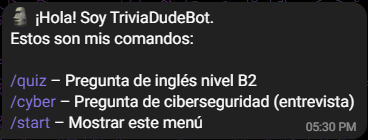


</div>

---

##  Tabla de contenido

|   | Sección | Qué encontrarás |
|---|---------|-----------------|
| 1 | [¿Qué es TriviaDudeBot?](#que-es) | Los tres comandos y aprendizajes |
| 2 | [Arquitectura](#arquitectura) | Diagramas del flujo y de la infraestructura |
| 3 | [Conceptos clave](#conceptos) | Glosario de terminos |
| 4 | [Requisitos](#requisitos) | Lo que necesitas antes de empezar |
| 5 | [Estructura del repositorio](#estructura) | Qué archivo hace qué |
| | **PARTE I · Desarrollo en Windows** | |
| 6 | [Docker Desktop](#docker-desktop) | WSL 2, instalación y verificación |
| 7 | [Descargar y ejecutar n8n](#n8n-pull) | `docker pull`, `docker run` y Docker Desktop |
| 8 | [Crear el bot (BotFather) y la API de Groq](#telegram-groq) | Token, menú de comandos, API key y modelo |
| 9 | [El túnel público (Cloudflare)](#tunel) | Por qué Telegram lo necesita y cómo abrirlo |
| 10 | [Pasar n8n a Docker Compose](#compose-windows) | `WEBHOOK_URL`, respaldo y migración del contenedor |
| 11 | [Construir el workflow de TriviaDudeBot](#workflow) | Trigger, Switch, menú, prompts, Groq, Code y quiz |
| | **PARTE II · Producción en Ubuntu Server** | |
| 12 | [Crear la VM en VirtualBox](#vm) | Hardware, disco y red |
| 13 | [Instalar Ubuntu Server](#ubuntu) | Instalador paso a paso |
| 14 | [Conectarte por SSH](#ssh) | IP, `ssh`, y alternativa con NAT |
| 15 | [Rendimiento de la VM](#rendimiento) | Qué hacer si va lenta |
| 16 | [Instalar Docker en Ubuntu](#docker-ubuntu) | Cada comando explicado |
| 17 | [Migrar n8n al servidor](#migracion) | `scp`, permisos, compose, túnel y publicación |
| 18 | [Operación diaria: cuando cambia la URL del túnel](#operacion) | Servidor Linux y Windows, paso a paso |
| 19 | [Mantenimiento](#mantenimiento) | Disco, respaldos, IP fija |
| | **PARTE III · Cierre** | |
| 20 | [Trabajar con dos entornos (servidor ↔ Windows)](#dos-entornos) | Exportar, importar y no pelear por el webhook |
| 25 | [Licencia y autoría](#licencia) | |


<a id="que-es"></a>

## 1.  ¿Qué es TriviaDudeBot?

**TriviaDudeBot** es un bot de Telegram de trivia con un **menú de comandos**, parecido al que muestra BotFather cuando le escribes `/start`. Hoy responde a tres comandos:

| Comando | Qué hace |
|---------|----------|
| `/start` | Muestra el **menú** con los comandos disponibles (los comandos son tocables). |
| `/quiz` | Lanza una pregunta de opción múltiple de **inglés nivel B2** (marco CEFR) sobre un tema al azar: gramática, vocabulario, *phrasal verbs*, colocaciones, condicionales, estilo indirecto, expresiones idiomáticas o conectores. |
| `/cyber` | Lanza una pregunta de opción múltiple de **ciberseguridad estilo entrevista** (nivel junior-intermedio) sobre un tema al azar: redes, criptografía, OWASP Top 10, autenticación, malware, respuesta a incidentes, *hardening*, firewalls e IDS/IPS, nube, ingeniería social, gestión de vulnerabilidades o SIEM. |

Las preguntas llegan como **quiz nativo de Telegram**: tocas una opción, Telegram marca si acertaste y muestra una **explicación en español**.

### Cómo funciona, en pocas palabras

1. n8n recibe tu mensaje.
2. Un nodo **Switch** lee el comando y decide por cuál camino seguir.
3. Si es `/start`, responde con el menú. Si es `/quiz` o `/cyber`, prepara las instrucciones (el *prompt*) para la IA.
4. **Groq** genera la pregunta en formato JSON.
5. Un nodo **Code** valida que el JSON sea correcto.
6. n8n envía la pregunta a Telegram como quiz.

Las dos ramas de quiz **comparten los mismos nodos de Groq, Code y envío**: lo único que cambia entre ellas es el prompt.

### Aprendizajes

- Instalar **Docker Desktop** en Windows con **WSL 2** y ejecutar **n8n** en un contenedor.
- Crear un bot con **BotFather**, registrar su menú de comandos y consumir una **API de IA** (Groq) desde n8n.
- Entender por qué los **webhooks** necesitan una URL pública y resolverlo con un **túnel de Cloudflare**.
- Enrutar mensajes con un nodo **Switch** y reutilizar una misma cadena de nodos con **Edit Fields**.
- Validar con un nodo **Code** lo que devuelve una IA, para que nunca llegue un quiz roto.
- Crear un **servidor Ubuntu en VirtualBox**, manejarlo por **SSH** e instalar **Docker**.
- **Migrar** el sistema entre Windows y el servidor sin perder credenciales, y evitar que dos n8n se disputen el mismo bot.
---

<a id="arquitectura"></a>

## 2.  Arquitectura

### 2.1 Qué pasa cuando escribes `/quiz` o `/cyber`


Con `/start` el recorrido es más corto: el Switch envía directamente el mensaje del menú, sin pasar por Groq.

### 2.2 Dónde vive cada pieza

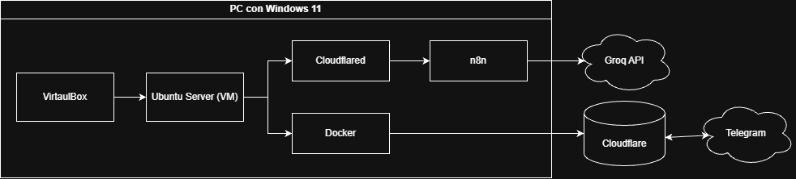

<a id="conceptos"></a>

## 3.  Conceptos clave

| Término | En palabras simples |
|---------|---------------------|
| **Docker** | Programa que ejecuta aplicaciones dentro de "cajas" aisladas llamadas contenedores. |
| **Imagen** | La "receta" empaquetada de una aplicación (por ejemplo `n8nio/n8n`). Se descarga con `docker pull`. |
| **Contenedor** | Una imagen en ejecución. Si lo borras, la app desaparece, pero **no** los datos guardados fuera de él. |
| **Volumen / bind mount** | Carpeta de tu PC conectada al interior del contenedor. Ahí vive tu información para que sobreviva. |
| **Docker Compose** | Archivo `docker-compose.yml` que describe un contenedor (imagen, puertos, variables, carpetas) para levantarlo con un solo comando. |
| **n8n** | Herramienta de automatización visual: conectas "nodos" para armar flujos. |
| **Nodo** | Cada bloque de un workflow (un disparador, un filtro, una llamada a una API…). |
| **Telegram Trigger** | Nodo que arranca el workflow cuando alguien le escribe al bot. |
| **Switch** | Nodo que reparte el flujo por **varias salidas** según una regla (aquí, según el comando). Un **IF** solo tiene dos: verdadero o falso. |
| **Edit Fields (Set)** | Nodo que guarda un dato con un nombre para que los siguientes lo usen (aquí, el prompt). |
| **Expresión (`fx`)** | Texto con `{{ ... }}` que n8n **calcula** en vez de tomarlo literal. En modo *Fixed*, el mismo texto se usa tal cual y no se calcula. |
| **Webhook** | Dirección web a la que un servicio (Telegram) envía un aviso cuando ocurre algo (un mensaje nuevo). |
| **Túnel (Cloudflare)** | Conexión que le da a tu n8n local una dirección pública HTTPS, para que Telegram pueda alcanzarlo. |
| **WSL 2** | Linux integrado en Windows. Docker Desktop lo usa como motor. |
| **VirtualBox** | Programa que crea computadores virtuales (VM) dentro de tu PC. |
| **Ubuntu Server** | Sistema operativo Linux sin interfaz gráfica, ideal para servidores. |
| **SSH** | Forma segura de controlar otro equipo escribiendo comandos desde tu terminal. |
| **Groq** | Servicio que ejecuta modelos de IA muy rápido mediante una API. |

---

<a id="requisitos"></a>

## 4.  Requisitos

| Necesitas | Para qué | Dónde |
|-----------|----------|-------|
| PC con **Windows 11** (64 bits) | Entorno de desarrollo y anfitrión de la VM | — |
| **Virtualización activada** en BIOS/UEFI | Docker Desktop y VirtualBox la necesitan | Se revisa en el Administrador de tarea, de estar desactivada se debe activar en BIOS |
| **16 GB de RAM** | Docker + VM funcionando a la vez | — |
| Cuenta de **Telegram** | Crear y probar el bot | telegram.org |
| Cuenta de **Groq** | API key del modelo de IA | console.groq.com |
| **Docker Desktop** | Ejecutar n8n en Windows | docker.com |
| **VirtualBox** | Crear el servidor virtual | virtualbox.org |
| **ISO de Ubuntu Server** | Instalar el sistema del servidor | ubuntu.com/download/server |
| **cloudflared** | Túnel público | Se instala con `winget` (Windows) o `.deb` (Ubuntu) |
| **VS Code** | Editar el compose y limpiar el JSON del workflow | code.visualstudio.com |

---

<a id="estructura"></a>

## 5.  Estructura del repositorio

```text
triviadudebot/
├── README.md              ← esta guía
├── docker-compose.yml     ← define el contenedor de n8n
├── .env.example           ← plantilla de variables
├── .gitignore             ← evita subir secretos y datos de n8n
├── workflows/
│   └── triviadudebot.json ← el workflow exportado y LIMPIO (sin token)
└── docs/
    └── images/            ← capturas usadas en este README
    └── icons/             ← iconos de tools
```
<br>

---

# PARTE I · Desarrollo en Windows

<a id="docker-desktop"></a>
 
## 6. <a href="https://www.docker.com/"></a> Docker Desktop 


Docker Desktop en Windows usa **WSL 2** (Linux dentro de Windows) como motor. Por eso, primero se prepara WSL y después se instala Docker Desktop.

### 6.1 Comprobar que la virtualización está activa

1. Abre el **Administrador de tareas** (`Ctrl + Shift + Esc`).
2. Ve a **Rendimiento → CPU**.
3. Abajo a la derecha debe decir **Virtualización: Habilitado**.


### 6.2 Instalar o actualizar WSL 2

Abre **PowerShell como administrador**:

```powershell
wsl --install
wsl --update
```

| Comando | Qué hace |
|---------|----------|
| `wsl --install` | Activa las características de Windows necesarias e instala WSL 2 con una distribución de Linux. |
| `wsl --update` | Actualiza el kernel de Linux que usa WSL a su versión más reciente. |

**Reinicia el PC** y comprueba:

```powershell
wsl --version
```

Debe mostrarte las versiones de WSL y del kernel.

<p align="center">
  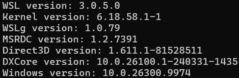<br>
  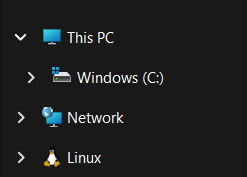<br>
<sub> Ahora sale el logo de Linux en el explorador de archivos</sub>

## 7. <a href="https://www.docker.com/"> Instalar Docker Desktop </a> y descargar (`pull`) a n8n

<a id="n8n-pull"></a>


### 7.1 Imagen vs. contenedor

- La **imagen** `n8nio/n8n` es el paquete oficial de n8n publicado en Docker Hub. Se descarga **una vez**.
- El **contenedor** es esa imagen funcionando. Puedes crearlo, detenerlo y borrarlo sin tocar la imagen.

### 7.2 Tutorial:
<p align="center">
<a href="https://www.youtube.com/watch?v=BfFkNou9m7k">
  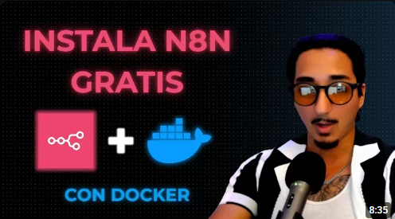
</a>
<br>
<sub>Creditos reservados al canal de Jaime Herrera por su tutorial</sub>
<br>
</p>

### 7.5 Comandos útiles para manejar el contenedor

| Comando | Para qué sirve |
|---------|----------------|
| `docker ps` | Lista los contenedores **en ejecución**. |
| `docker ps -a` | Lista todos, también los detenidos. |
| `docker logs -f n8n_local` | Muestra los registros en vivo (`Ctrl+C` para salir). |
| `docker stop n8n_local` | Detiene el contenedor. |
| `docker start n8n_local` | Lo vuelve a arrancar. |
| `docker restart n8n_local` | Lo reinicia. |
| `docker rm n8n_local` | Borra el contenedor (**no** borra tu carpeta de datos). |

---

<a id="telegram-groq"></a>

## 8.  Crear el bot (BotFather) y la API de Groq

### 8.1 Crear el bot en Telegram con BotFather

**BotFather** es el bot oficial de Telegram para crear y administrar bots. Si le escribes `/start`, te muestra justo el tipo de menú que vas a construir para tu propio bot: una lista de comandos tocables.

1. En Telegram, busca **@BotFather** (el que tiene la insignia de verificación azul) y ábrelo.
2. Envía el comando:
   ```text
   /newbot
   ```
3. **Nombre del bot** (el que se muestra en el chat): `TriviaDudeBot`.
4. **Username** (debe ser único y **terminar en `bot`**): por ejemplo `TriviaDudeBot`. Si está ocupado, prueba una variante (`TriviaDude_bot`, `MiTriviaDudeBot`…).
5. BotFather te responde con el **token**, algo como `123456789:AAH...`. **Guárdalo**: es la contraseña de tu bot.

Comandos de BotFather que conviene conocer:

| Comando | Qué hace |
|---------|----------|
| `/setdescription` | Texto que se muestra cuando alguien abre el bot por primera vez. |
| `/setabouttext` | Texto corto del perfil del bot. |
| `/setuserpic` | Foto de perfil del bot. |
| `/setcommands` | Registra el **menú de comandos** del bot (ver 8.2). |
| `/token` | Muestra el token actual del bot. |
| `/revoke` | Genera un token nuevo e invalida el anterior. |
| `/deletebot` | Elimina el bot. |


### 8.2 Registrar el menú de comandos (`/setcommands`)

Este paso es **opcional pero recomendado**: hace que Telegram muestre una lista de sugerencias al escribir `/` y un botón de menú junto al campo de texto.

1. Envía `/setcommands` a BotFather y elige tu bot.
2. Responde con **una línea por comando**, sin la barra `/` y con un guion que separa el nombre de la descripción:

```text
start - Ver el menú de comandos
quiz - Pregunta de inglés nivel B2
cyber - Pregunta de ciberseguridad de entrevista
```

<p align="center">
  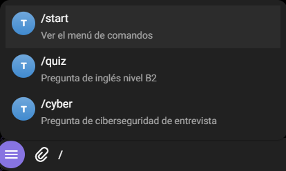<br>
  <sub>

### 8.3 Obtener tu `chat_id` (opcional)

1. En n8n, abre el **Telegram Trigger** y pulsa **Listen for test event**.
2. Escríbele un mensaje al bot.
3. En el panel **Output** del trigger, despliega `message → chat → id`. Ese número es tu `chat_id`.

### 8.4 <a href="https://console.groq.com/keys"></a> Obtener la API key de Groq

1. Entra a **console.groq.com** e inicia sesión.
2. Ve a **API Keys → Create API Key**.
3. Ponle un nombre y **copia la clave**: solo se muestra una vez.


### 8.5 Elegir el modelo

En la documentación de Groq (`console.groq.com/docs/models`) hay una tabla de **Production Models**.

Los que sí tenían límites y precio para el plan Developer eran:

| Modelo (ID exacto) | Cuándo usarlo |
|--------------------|---------------|
| `openai/gpt-oss-120b` | **Recomendado.** Más capaz: genera preguntas con una sola respuesta correcta y explicaciones fiables. |
| `openai/gpt-oss-20b` | Más rápido y barato; sirve para preguntas más simples. |

<br>

<a id="tunel"></a>

## 9. <a></a> El túnel público (Cloudflare)

### 9.1 El problema

El **Telegram Trigger** de n8n funciona con un **webhook**: cuando alguien escribe al bot, los servidores de Telegram envían un aviso a una URL tuya. Pero Telegram **solo acepta direcciones públicas con HTTPS**, y tu n8n es `http://localhost:5678`, que solo existe dentro de tu PC.

### 9.2 La solución

**cloudflared** abre una conexión **de salida** desde tu equipo hacia Cloudflare, y Cloudflare te da una dirección pública HTTPS que reenvía todo a n8n.

<a> 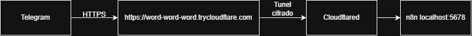
</a>

### 9.3 Instalar y abrir el túnel en Windows

```powershell
winget install Cloudflare.cloudflared
```

Cierra y vuelve a abrir PowerShell y verifica:

```powershell
cloudflared --version
```

Abre el túnel:

```powershell
cloudflared tunnel --url http://localhost:5678
```

| Parte | Significado |
|-------|-------------|
| `cloudflared tunnel` | Inicia un túnel. |
| `--url http://localhost:5678` | A qué servicio local debe reenviar el tráfico (tu n8n). |

Tras unos segundos verás un recuadro con tu URL pública:


<p align="center">
  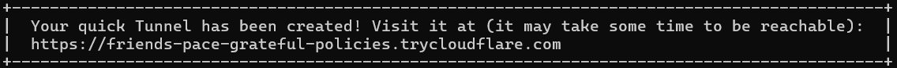<br>
</p>

**Cópiala y comprueba** que funciona abriéndola en el navegador: debe aparecer login de n8n.


> [!WARNING]
> - **Deja esa ventana de PowerShell abierta.** Si la cierras (o pulsas `Ctrl+C`), el túnel se apaga y el bot deja de recibir mensajes.
> - La URL **cambia cada vez** que reinicias el túnel.
> - Cualquiera con la URL puede ver tu pantalla de login de n8n.

---

<a id="compose-windows"></a>

## 10.  Pasar n8n a Docker Compose (`WEBHOOK_URL`)

Para que n8n **registre correctamente el webhook** en Telegram, debe conocer su dirección pública. Eso se hace con la variable **`WEBHOOK_URL`**. La forma ordenada de manejarla es con un `docker-compose.yml`.


### 10.1 Las dos carpetas: datos y configuración

Al terminar esta sección tendrás **dos carpetas distintas** en tu PC. Es normal, y conviene tener claro qué hace cada una:

| Carpeta | Qué contiene | ¿La tocas? |
|---------|--------------|------------|
| `C:\Users\TU_USUARIO\n8n` | Los **datos** de n8n: `database.sqlite` (tus workflows, credenciales e historial), `config` (la clave de cifrado), y las carpetas `nodes` y `storage`. | **No**, nunca a mano. |
| `C:\Users\TU_USUARIO\n8n-docker` | La **configuración del contenedor**: el `docker-compose.yml`. | Solo para cambiar variables como `WEBHOOK_URL`. |

Tu workflow **está dentro de `database.sqlite`**. No hay un archivo del workflow que buscar: se edita desde el navegador, en `http://localhost:5678`.


### 10.2 Los archivos del proyecto

Crea la carpeta `C:\Users\TU_USUARIO\n8n-docker`.

**`docker-compose.yml`**

```yaml
services:
  n8n:
    image: n8nio/n8n:latest
    container_name: n8n_local
    restart: unless-stopped
    ports:
      - "5678:5678"
    environment:
      - GENERIC_TIMEZONE=America/Bogota
      - TZ=America/Bogota
      - WEBHOOK_URL=${WEBHOOK_URL:?Define WEBHOOK_URL en el archivo .env}
      - N8N_SECURE_COOKIE=false
    volumes:
      - ${N8N_DATA_DIR:?Define N8N_DATA_DIR en el archivo .env}:/home/node/.n8n
```

**`.env.example`**

```dotenv
WEBHOOK_URL=https://palabra-palabra-palabra.trycloudflare.com/
N8N_DATA_DIR=C:/Users/TU_USUARIO/n8n
```

| Línea | Para qué sirve |
|-------|----------------|
| `image: n8nio/n8n:latest` | La misma imagen que ya descargaste. |
| `container_name: n8n_local` | Mantiene el nombre del contenedor. |
| `restart: unless-stopped` | El contenedor arranca solo cuando Docker arranca (útil en el servidor). |
| `ports: "5678:5678"` | Mismo mapeo de puertos que antes. |
| `GENERIC_TIMEZONE` / `TZ` | Zona horaria de Bogotá, para que los horarios de n8n sean correctos. |
| `WEBHOOK_URL` | **La clave de este paso**: la URL pública del túnel (con `https://` y **terminada en `/`**). |
| `N8N_SECURE_COOKIE=false` | Permite iniciar sesión entrando por `http://` desde otro equipo de tu red local (por ejemplo `http://IP_DEL_SERVIDOR:5678`). Quítala si algún día usas HTTPS propio. |
| `${WEBHOOK_URL:?...}` | Toma el valor del `.env`; si falta, Compose se detiene con un mensaje claro en vez de arrancar mal. |
| `volumes: ...:/home/node/.n8n` | **Tu misma carpeta de datos** conectada al contenedor. |

> [!NOTE]
> **Dos formas de escribir la URL.** En esta guía el compose lee `WEBHOOK_URL` desde un archivo `.env`. También es válido escribirla directamente en el compose, como `- WEBHOOK_URL=https://...trycloudflare.com/`. Cualquiera de las dos funciona; lo importante es saber **cuál tienes tú**, porque es el archivo que debes editar cuando cambie el túnel.

### 10.3 Reemplazar el contenedor

El contenedor antiguo ya está detenido. Bórralo (esto **no** borra tu carpeta de datos) y levanta el nuevo con Compose:

```powershell
docker rm n8n_local
cd C:\Users\TU_USUARIO\n8n-docker
docker compose up -d
```

| Comando | Qué hace |
|---------|----------|
| `docker rm n8n_local` | Elimina solo el contenedor viejo, para liberar el nombre. |
| `cd ...` | Entra a la carpeta donde está el `docker-compose.yml`. |
| `docker compose up -d` | Lee el compose y el `.env`, crea el contenedor y lo deja corriendo en segundo plano. Si ya existe y **no cambió nada**, dice `Running`; si cambiaste una variable, lo **recrea** (`Recreated`/`Started`). |
| `docker compose up -d --force-recreate` | Fuerza que lo recree **siempre**. Útil cuando dudas de si tomó los cambios. |

> [!CAUTION]
> **Nunca usar `docker compose down -v`**: la opción `-v` elimina volúmenes y podrías perder datos.


### 10.4 Verificar

```powershell
docker compose exec n8n printenv WEBHOOK_URL
```

Debe imprimir la URL de tu túnel. Después abre `http://localhost:5678` y confirma que tus workflows y credenciales siguen ahí.

---

<a id="workflow"></a>

## 11. Construir el workflow de TriviaDudeBot

### 11.0 La idea antes de los clics

Hay tres comandos y cada uno debe hacer algo distinto. Para repartirlos se usa un nodo **Switch**:

| Nodo | Salidas | Cuándo usarlo |
|------|---------|---------------|
| **IF** | 2 (verdadero / falso) | Cuando solo hay una pregunta de sí o no. |
| **Switch** | Una por cada regla (3, 4, 5…) | Cuando hay varios caminos posibles, como aquí: `/start`, `/quiz` y `/cyber`. |

Y para no repetir nodos, las dos ramas de quiz **comparten la misma cadena** (Groq → Code → envío del quiz). Cada rama solo deja antes un "papelito" con las instrucciones para la IA, y Groq lo lee:


<p align="center">
  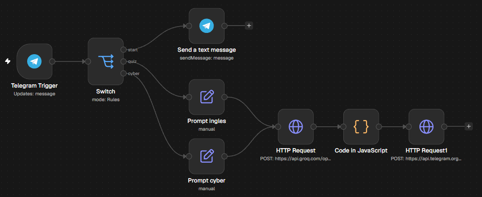<br>
</p>


### 11.1 Crear las credenciales

En n8n: **Credentials → Create credential** (o desde dentro de cada nodo).

**Credencial de Groq (Header Auth)**

| Campo | Valor |
|-------|-------|
| Tipo | **Header Auth** |
| Name | `Authorization` |
| Value | `Bearer TU_API_KEY_DE_GROQ` (la palabra `Bearer`, un espacio y la clave) |

<br>

**Credencial de Telegram**

| Campo | Valor |
|-------|-------|
| Tipo | **Telegram API** |
| Access Token | El token que brindo BotFather para **TriviaDudeBot** |


### 11.2 Nodo 1 · Telegram Trigger

Es el **disparador**: se activa cada vez que alguien escribe al bot.

1. Click en **+** (*Add first step*) y busca **Telegram Trigger** → **On message**.
2. **Credential:** elige la credencial de Telegram de TriviaDudeBot.
3. **Updates:** `message`.
4. Déjalo con el nombre **`Telegram Trigger`**: otros nodos lo referencian por ese nombre.

<p align="center">
  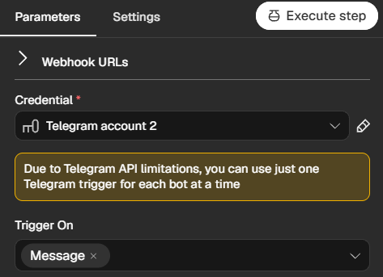<br>
</p>

> [!NOTE]
> Este nodo **requiere** el túnel y `WEBHOOK_URL` de las secciones 9 y 10. Si no, n8n mostrará un error pidiendo una URL HTTPS, o *"bad webhook: Failed to resolve host"*.

### 11.3 Nodo 2 · Switch (el repartidor de comandos)

1. Agrega un **Switch** después del trigger. **Mode:** *Rules*.
2. Crea **3 reglas** (*Add Routing Rule*). En **todas**, *Value 1* es esta expresión y el operador es **String → is equal to**:

```text
{{ ($json.message.text || '').trim().toLowerCase().split(/[\s@]/)[0] }}
```

| Regla | Value 2 | Renombrar salida a |
|-------|---------|--------------------|
| 1 | `/start` | `start` |
| 2 | `/quiz` | `quiz` |
| 3 | `/cyber` | `cyber` |

3. Activa **Rename Output** en cada regla y escribe el nombre de la tabla, para identificar las salidas en el lienzo.

<p align="center">
  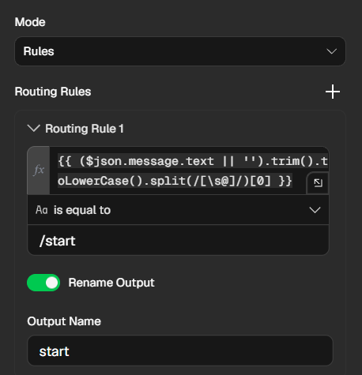<br>
</p>

**Qué hace la expresión, por partes:**

| Parte | Para qué sirve |
|-------|----------------|
| `$json.message.text` | El texto que escribió el usuario. |
| `\|\| ''` | Si el mensaje no tiene texto (una foto, un sticker), usa un texto vacío en vez de dar error. |
| `.trim()` | Quita espacios al inicio y al final. |
| `.toLowerCase()` | Pasa a minúsculas, así `/QUIZ` también funciona. |
| `.split(/[\s@]/)[0]` | Se queda con lo que va **antes de un espacio o una `@`**. Así `/quiz@TriviaDudeBot` (como llega en los grupos) y `/quiz algo` se reconocen como `/quiz`. |

> [!WARNING]
> **El error más común de este nodo: el campo en modo *Fixed*.** Si pegas la expresión y el campo queda en modo fijo, n8n la trata como **texto literal** y nunca coincide con ningún comando: el flujo se detiene **sin mostrar ningún error** y el bot parece mudo. Reconocerlo es fácil: un campo en modo *Expression* muestra el icono **`fx`** a la izquierda y el texto resaltado en **verde**. Si no lo ves, pasa el mouse sobre el campo y cambia **Fixed** por **Expression**.

### 11.4 Nodo 3 · Send a text message (el menú de `/start`)

Conecta la salida **start** a un nodo **Telegram → Send a text message** (*Resource:* Message, *Operation:* Send Message):

| Campo | Valor |
|-------|-------|
| **Credential** | La de TriviaDudeBot |
| **Chat ID** | `{{ $('Telegram Trigger').first().json.message.chat.id }}` |
| **Text** | El menú (ver abajo) |

**Text:**

```text
🗿 ¡Hola! Soy TriviaDudeBot.

Estos son mis comandos:

/quiz – Pregunta de inglés nivel B2
/cyber – Pregunta de ciberseguridad (entrevista)
/start – Mostrar este menú
```

Además, en **Add Field** busca **Append n8n Attribution** y **desactívalo**: viene activado por defecto y añade una línea de "enviado con n8n" al mensaje.


### 11.5 Nodos 4 y 5 · Edit Fields: el "papelito" con el prompt

Las salidas **quiz** y **cyber** del Switch van cada una a un nodo **Edit Fields (Set)**. Este nodo solo hace una cosa: guarda un texto con un nombre. Aquí, el nombre es **`systemPrompt`**, y es lo que el nodo de Groq va a leer.

```text
Switch ──► quiz  ──► [Edit Fields: prompt de inglés]  ──┐
       └─► cyber ──► [Edit Fields: prompt de cyber]   ──┴─► Groq (lee systemPrompt)
```

Para cada nodo: **Mode:** *Manual Mapping* → **Add Field** → **Name** `systemPrompt`, **Type** *String*, **Value** el texto de abajo. Renombra los nodos a **`Prompt inglés`** y **`Prompt cyber`**.

**Value de `Prompt inglés`:**

```text
You are an English teacher. Generate ONE multiple-choice question at CEFR B2 level. Topic: {{ ['grammar','vocabulary','phrasal verbs','collocations','conditionals','reported speech','idioms','linkers'].sort(() => Math.random() - 0.5)[0] }}. Return ONLY a JSON object with these keys: question (string, max 280 chars), options (array of exactly 4 strings, max 90 chars each), correct_index (integer 0-3), explanation (string, max 190 chars, in Spanish). Randomize the position of the correct answer.
```

<p align="center">
  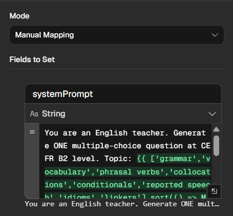<br>
</p>

**Value de `Prompt cyber`:**

```text
You are a cybersecurity interviewer preparing a candidate for a junior-to-mid level security job interview (SOC analyst, pentester or security engineer). Generate ONE multiple-choice question about: {{ ['networking (TCP/IP, DNS, ports)','cryptography','OWASP Top 10','authentication and access control','malware','incident response','Linux and Windows hardening','firewalls and IDS/IPS','cloud security','social engineering','vulnerability management','SIEM and log analysis'].sort(() => Math.random() - 0.5)[0] }}. Write the question and options in English. It must be realistic for a job interview, with exactly one clearly correct answer and three plausible distractors. Return ONLY a JSON object with these keys: question (string, max 280 chars), options (array of exactly 4 strings, max 90 chars each), correct_index (integer 0-3), explanation (string, max 190 chars, in Spanish). Randomize the position of the correct answer.
```

<p align="center">
  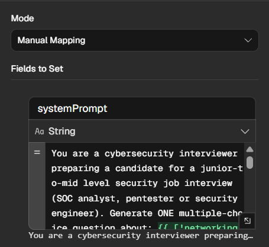<br>
</p>

| Parte del prompt | Para qué sirve |
|------------------|----------------|
| Rol (*teacher* / *interviewer*) | Define el tipo de pregunta y su nivel. |
| `{{ [...].sort(() => Math.random() - 0.5)[0] }}` | Expresión de n8n que elige **un tema al azar** de la lista en cada ejecución. Para agregar temas, solo añade elementos a la lista: no hay que contar cuántos son. |
| `Return ONLY a JSON object with these keys...` | Fija el formato exacto de la respuesta y los **límites de longitud** que exige Telegram para los quizzes. |
| `in Spanish` (en `explanation`) | La explicación sale en español. Si quieres las preguntas de `/cyber` en español, cambia `Write the question and options in English`. |

> [!NOTE]
> El formato JSON se describe **con palabras** y no con llaves `{ }` a propósito: dentro de un campo de n8n, las llaves pueden confundirse con las expresiones `{{ }}`.

**Cómo comprobar que quedó bien:** el texto lleva `{{ ... }}`, así que debe estar en modo **Expression**. Si lo está, debajo del campo aparece una vista previa del **Resultado** con un tema ya elegido. Si ves los corchetes y las llaves literales, cambia el campo de **Fixed** a **Expression**.

### 11.6 Nodo 6 · HTTP Request a Groq (compartido)

Conecta **las salidas de los dos nodos de prompt** a este único nodo. n8n permite varias conexiones entrantes al mismo nodo, y solo se ejecuta la rama que se activó.

| Campo | Valor |
|-------|-------|
| **Method** | `POST` |
| **URL** | `https://api.groq.com/openai/v1/chat/completions` |
| **Authentication** | *Generic Credential Type* → **Header Auth** → tu credencial de Groq |
| **Send Body** | Activado → *Body Content Type:* **JSON** → *Specify Body:* **Using JSON** |

**Body:**

```json
{
  "model": "openai/gpt-oss-120b",
  "temperature": 1,
  "reasoning_effort": "low",
  "response_format": { "type": "json_object" },
  "messages": [
    { "role": "system", "content": {{ JSON.stringify($json.systemPrompt) }} },
    { "role": "user", "content": "Give me a new question." }
  ]
}
```

| Parte del body | Para qué sirve |
|----------------|----------------|
| `model` | El modelo de Groq. |
| `temperature: 1` | Más variedad: no repite siempre las mismas preguntas. |
| `reasoning_effort: "low"` | Estos modelos "razonan" antes de responder; así lo hacen rápido y gastan menos tokens. Si Groq se queja de este parámetro, bórralo. |
| `response_format: json_object` | Pide que la respuesta sea JSON válido. Si diera error, quítalo: el prompt ya exige JSON y el nodo Code lo limpia. |
| `{{ JSON.stringify($json.systemPrompt) }}` | **La clave de la reutilización:** toma el campo `systemPrompt` que dejó el nodo anterior (inglés o cyber) y lo inserta de forma segura dentro del JSON. |

<p align="center">
  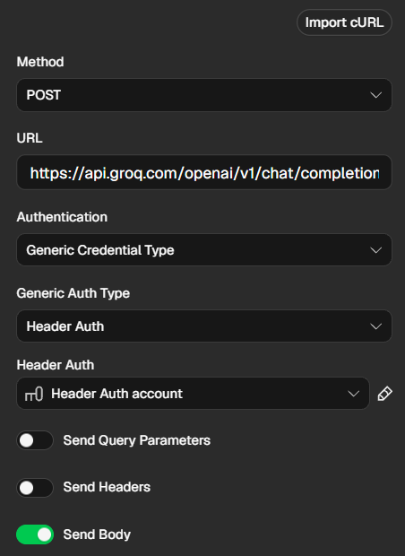<br>
</p>

### 11.7 Nodo 7 · Code (parsear y validar)

La respuesta de Groq llega como **texto** dentro de `choices[0].message.content`. Este nodo la convierte en datos utilizables y **comprueba que sean correctos** antes de enviarlos.

**Configuración:** *Mode:* **Run Once for All Items**, *Language:* JavaScript.

````javascript
const raw = $input.first().json.choices[0].message.content
  .replace(/```json|```/g, '')
  .trim();

const q = JSON.parse(raw);

// Validaciones para evitar quizzes rotos
if (!Array.isArray(q.options) || q.options.length !== 4) {
  throw new Error('La IA no devolvió 4 opciones');
}
if (!Number.isInteger(q.correct_index) || q.correct_index < 0 || q.correct_index > 3) {
  throw new Error('correct_index inválido');
}

return [{ json: q }];
````

| Línea | Qué hace |
|-------|----------|
| `$input.first().json.choices[0].message.content` | Toma el texto que generó la IA. |
| ``.replace(/```json\|```/g, '')`` | Quita las marcas de código (tres tildes invertidas) que algunos modelos agregan alrededor del JSON. |
| `.trim()` | Elimina espacios y saltos de línea sobrantes. |
| `JSON.parse(raw)` | Convierte el texto en un objeto con `question`, `options`, `correct_index` y `explanation`. |
| Los dos `if` con `throw new Error` | Garantizan que haya **exactamente 4 opciones** y que `correct_index` sea un entero entre 0 y 3. Si no, el flujo falla con un mensaje claro en lugar de mandar un quiz roto. |
| `return [{ json: q }]` | Entrega el objeto al siguiente nodo. |


### 11.8 Nodo 8 · HTTP Request: `sendPoll` de Telegram

Envía la pregunta como **quiz**. Se usa HTTP Request porque el nodo nativo de Telegram no incluye la opción de encuestas tipo quiz.

| Campo | Valor |
|-------|-------|
| **Method** | `POST` |
| **URL** | `https://api.telegram.org/botTU_TOKEN_AQUI/sendPoll` |
| **Authentication** | `None` |
| **Send Body** | Activado → **JSON** → **Using JSON** |

**Body:**

```json
{
  "chat_id": {{ $('Telegram Trigger').first().json.message.chat.id }},
  "question": {{ JSON.stringify($json.question) }},
  "options": {{ JSON.stringify($json.options) }},
  "type": "quiz",
  "correct_option_id": {{ $json.correct_index }},
  "explanation": {{ JSON.stringify($json.explanation) }},
  "is_anonymous": false
}
```

| Campo del body | Significado |
|----------------|-------------|
| `chat_id` | A quién responder: el chat del que llegó el mensaje. Se lee del trigger con **`.first()`**, porque aquí el nodo recibe datos de dos ramas distintas y con `.item` n8n a veces no sabe con qué mensaje emparejarlos (*Paired item data unavailable*). |
| `question` / `options` / `explanation` | Se pasan con `JSON.stringify(...)` para que las comillas y los caracteres especiales no rompan el JSON. |
| `type: "quiz"` | Encuesta con **una respuesta correcta**. |
| `correct_option_id` | Posición (0 a 3) de la respuesta correcta. |
| `is_anonymous: false` | Necesario para que el quiz se comporte normalmente en chats privados. |

**Límites de Telegram:** pregunta máx. **300** caracteres, cada opción **100**, explicación **200**. Por eso los prompts piden longitudes más cortas.

### 11.9 Publicar el workflow

El modo prueba registra un webhook **temporal**. Para que el bot responda solo, sin el editor abierto, hay que **publicar** (activar) el workflow:

1. Arriba a la derecha, pulsa **Publish** (en versiones anteriores, el interruptor **Active**).
2. Confirma en la ventana que aparece.


**Comprueba que Telegram tiene registrado tu webhook** abriendo en el navegador:

```text
https://api.telegram.org/botTU_TOKEN_AQUI/getWebhookInfo
```

Debes ver algo así (sin `last_error_message`):

```json
{"ok":true,"result":{"url":"https://palabra-palabra-palabra.trycloudflare.com/webhook/.../webhook","has_custom_certificate":false,"pending_update_count":0,"max_connections":40,"allowed_updates":["message","callback_query"]}}
```

| Campo | Cómo interpretarlo |
|-------|--------------------|
| `url` | Debe empezar con la URL de **tu túnel actual**. Si está **vacío**, el workflow no está publicado o no se pudo activar. |
| `last_error_message` | Si aparece, dice exactamente por qué Telegram no puede entregar los mensajes. |
| `pending_update_count` | Mensajes pendientes de entregar. Debe ser 0 o muy bajo. |

> [!IMPORTANT]
> Telegram solo admite **un webhook por bot**. Si el mismo workflow está publicado en dos n8n (por ejemplo, el de Windows y el del servidor), **se quitan el webhook uno al otro**.

<br><br>

# PARTE II · Producción en Ubuntu Server

Hasta aquí el bot funciona en tu PC con Windows. Ahora lo llevamos a un **servidor Ubuntu** que corre en una máquina virtual, para que sea un servicio separado de tu entorno de desarrollo.

<p align="center">
<a>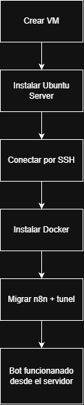
</p>

---

<a id="vm"></a>

## 12. Crear la VM en VirtualBox

Imagen ISO de ubuntu server <a href="https://ubuntu.com/download/server">Aqui </a>
1. Abre VirtualBox y pulsa **Nueva** (*New*).
2. **Nombre:** `ubuntu-server`. **Imagen ISO:** selecciona la ISO de Ubuntu Server que descargaste. VirtualBox suele detectar *Tipo:* **Linux** y *Versión:* **Ubuntu (64-bit)**; si no, ponlos a mano.
3. Marcar **Skip Unattended Installation** para instalar manualmente y ver cada paso.
4. **Hardware:**

| Recurso | Valor recomendado |
|---------|-------------------|
| Memoria RAM | **4096 MB**
| Procesadores | **2 CPU** |
| Disco duro | Crear uno nuevo de **30 GB** |

5. Pulsa **Finalizar**.


### Configurar la red (antes de encenderla)

Selecciona la VM → **Configuración → Red → Adaptador 1**:

- **Conectado a:** **Adaptador puente** (*Bridged Adapter*), y elige la tarjeta que usas (Wi-Fi o Ethernet).

Así la VM recibe una IP de tu **red local** y puedes entrar a ella desde Windows.

<p align="center">
  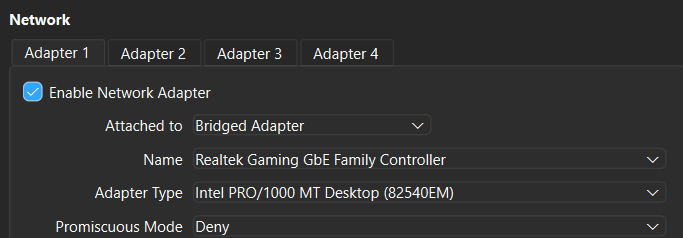<br>
</p>

---

<a id="ubuntu"></a>

## 13.  Instalar Ubuntu Server

Inicia la VM. El instalador se maneja **solo con el teclado**: flechas para moverte, **Espacio** para marcar y **Enter** para continuar.

| # | Pantalla | Qué elegir |
|---|----------|------------|
| 1 | Idioma / Teclado | El inglés es habitual en servidores. |
| 2 | Tipo de instalación | **Ubuntu Server** (no la versión minimizada). |
| 3 | Red | Déjala en DHCP; debe mostrar una IP `192.168.x.x` (o similar). |
| 4 | Proxy y mirror | N/A. |
| 5 | Almacenamiento | Usar todo el disco con las opciones por defecto y confirmar. Es el **disco virtual**, no tu disco real. |
| 6 | Perfil | Tu nombre, nombre del servidor (`ubuntu-server`), **usuario y contraseña** (anótalos). |
| 7 | Ubuntu Pro | *Skip*. |
| 8 | **SSH** | Marca con Espacio **Install OpenSSH server**. Es clave para controlarlo desde Windows. |
| 9 | Featured snaps | N/A |

Esperar a que termine y pulsa **Reboot Now**.

**Si al reiniciar vuelve a aparecer el instalador**, expulsa la ISO: en la ventana de la VM, menú **Dispositivos → Unidades ópticas → Quitar disco de la unidad virtual**, y reinicia.

---

<a id="ssh"></a>

## 14.  →  Conectarte por SSH desde Windows

**SSH** te permite escribir comandos en el servidor desde PowerShell, con copiar y pegar, mucho más cómodo que la consola de VirtualBox.

### 14.1 Averiguar la IP del servidor

En la consola de la VM:

```bash
ip -4 a
```

| Parte | Significado |
|-------|-------------|
| `ip` | Herramienta de red de Linux. |
| `-4` | Muestra solo direcciones IPv4. |
| `a` | Abreviatura de `address`: lista las interfaces y sus IP. |

La línea `inet 192.168.x.x/24` de la interfaz principal (algo como `enp0s3`). Esa es la IP del servidor.

### 14.2 Conectarte

Desde **PowerShell en Windows**:

```powershell
ssh TU_USUARIO@IP_DEL_SERVIDOR
```

| Parte | Significado |
|-------|-------------|
| `ssh` | Cliente SSH incluido en Windows. |
| `TU_USUARIO` | El usuario que creaste en la instalación. |
| `@IP_DEL_SERVIDOR` | La dirección a la que te conectas. |

- La primera vez pregunta si confías en la huella del servidor: escribe `yes`.
- Luego pide la contraseña (tampoco se ve al escribirla).
- Si todo va bien, verás el mensaje de bienvenida de Ubuntu y un prompt `usuario@ubuntu-server:~$`.

Para salir de la sesión: `exit`.

### 14.3 Alternativa: NAT con reenvío de puertos

Si el modo puente no te da IP, deja el adaptador en **NAT** y ve a **Avanzadas → Reenvío de puertos**. Agrega:

| Nombre | Puerto host | Puerto invitado |
|--------|-------------|-----------------|
| ssh | 2222 | 22 |
| n8n | 5679 | 5678 |

Te conectas con:

```powershell
ssh -p 2222 TU_USUARIO@127.0.0.1
```

(`-p 2222` indica el puerto. Se usa 5679 para n8n porque el 5678 ya lo ocupa el n8n de Windows).

---

<a id="rendimiento"></a>

---

<a id="docker-ubuntu"></a>

## 15.  →  Instalar Docker en Ubuntu

Entra al servidor por SSH. Vas a decirle a Ubuntu **de dónde descargar Docker** y **cómo comprobar que los paquetes son auténticos**.

### 16.1 Preparar el sistema y la clave de Docker

```bash
sudo apt update && sudo apt upgrade -y
sudo apt install -y ca-certificates curl
sudo install -m 0755 -d /etc/apt/keyrings
sudo curl -fsSL https://download.docker.com/linux/ubuntu/gpg -o /etc/apt/keyrings/docker.asc
sudo chmod a+r /etc/apt/keyrings/docker.asc
```

| Comando | Qué hace |
|---------|----------|
| `sudo` | Ejecuta el comando con permisos de administrador. |
| `apt update` | No instala nada: refresca la lista de paquetes disponibles. |
| `&&` | Ejecuta el segundo comando solo si el primero terminó bien. |
| `apt upgrade -y` | Actualiza los paquetes ya instalados. `-y` responde "sí" a las confirmaciones. |
| `apt install -y ca-certificates curl` | `ca-certificates`: lista de autoridades de confianza para validar páginas HTTPS. `curl`: descarga archivos desde la terminal. |
| `install -m 0755 -d /etc/apt/keyrings` | Crea la carpeta estándar para claves de repositorios. `-d` crea el directorio y `-m 0755` fija permisos: root escribe, los demás leen y entran. |
| `curl -fsSL ... -o ...docker.asc` | Descarga la **clave pública GPG de Docker**. `-f`: no guardar páginas de error; `-s`: silencioso; `-S`: mostrar errores aun así; `-L`: seguir redirecciones; `-o`: dónde guardar. |
| `chmod a+r ...docker.asc` | Da permiso de **lectura a todos**, necesario para que `apt` pueda leer la clave. |


Para confirmar que la clave quedó guardada:

```bash
ls -l /etc/apt/keyrings/
head -n 1 /etc/apt/keyrings/docker.asc
```

Debe aparecer `docker.asc` y la primera línea debe ser `-----BEGIN PGP PUBLIC KEY BLOCK-----`.

### 16.2 Agregar el repositorio oficial de Docker

```bash
echo "deb [arch=$(dpkg --print-architecture) signed-by=/etc/apt/keyrings/docker.asc] https://download.docker.com/linux/ubuntu $(. /etc/os-release && echo "${UBUNTU_CODENAME:-$VERSION_CODENAME}") stable" | sudo tee /etc/apt/sources.list.d/docker.list > /dev/null
```

| Pieza | Significado |
|-------|-------------|
| `deb` | Fuente de paquetes ya compilados. |
| `arch=$(dpkg --print-architecture)` | Pone la arquitectura de tu sistema (normalmente `amd64`). `$(...)` ejecuta el comando y usa su resultado. |
| `signed-by=/etc/apt/keyrings/docker.asc` | Qué clave debe verificar los paquetes: la que descargaste. |
| `https://download.docker.com/linux/ubuntu` | El repositorio oficial de Docker. |
| `$(. /etc/os-release && echo "${UBUNTU_CODENAME:-$VERSION_CODENAME}")` | Obtiene el **nombre en clave de tu versión de Ubuntu** (por ejemplo `noble`, `resolute`) desde `/etc/os-release`. |
| `stable` | El canal estable. |
| `\| sudo tee /etc/apt/sources.list.d/docker.list` | `\|` pasa el texto al siguiente comando; `tee` lo escribe en un archivo. Se usa `sudo tee` porque una redirección normal (`>`) no hereda los permisos de `sudo`. |
| `> /dev/null` | Descarta la copia que `tee` mostraría en pantalla. |

Comprueba el resultado:

```bash
cat /etc/apt/sources.list.d/docker.list
```

Debe mostrar **una sola línea** con el nombre en clave de tu Ubuntu al final (antes de `stable`).

### 16.3 Instalar Docker

```bash
sudo apt update
sudo apt install -y docker-ce docker-ce-cli containerd.io docker-buildx-plugin docker-compose-plugin
sudo usermod -aG docker $USER
```

> [!NOTE]
> En el `apt update` busca líneas con `download.docker.com`: si aparece `Get:` o `Hit:`, el repositorio funciona. Si ves `404 Not Found` o *does not have a Release file*, Docker aún no publica paquetes para tu versión de Ubuntu; en ese caso puedes instalar `docker.io` y `docker-compose-v2` desde los repositorios de Ubuntu.

| Paquete | Qué es |
|---------|--------|
| `docker-ce` | El motor de Docker. |
| `docker-ce-cli` | El comando `docker`. |
| `containerd.io` | El *runtime* que ejecuta los contenedores. |
| `docker-buildx-plugin` | Constructor avanzado de imágenes. |
| `docker-compose-plugin` | Habilita `docker compose`. |
| `usermod -aG docker $USER` | Agrega tu usuario al grupo `docker` para usarlo **sin `sudo`**. |

### 16.4 Verificar

Cierra la sesión (`exit`), vuelve a entrar por SSH (para que el grupo se aplique) y ejecuta:

```bash
docker run hello-world
docker compose version
```

Si aparece **"Hello from Docker!"** y la versión de Compose, el servidor está listo.
  

---

<a id="migracion"></a>

## 17.  →  Migrar n8n al servidor

La estrategia es **copiar toda la carpeta de datos** de n8n (workflows, credenciales y clave de cifrado) al servidor. Así **no tienes que recrear nada**.

### 17.1 Dejar el n8n de Windows apagado

Telegram solo admite **un webhook por bot**. Detén el n8n de Windows y **no lo vuelvas a encender** mientras pruebas el servidor, porque al arrancar reclamaría el webhook:

```powershell
cd C:\Users\TU_USUARIO\n8n-docker
docker compose stop
```

Cierra también la ventana del túnel de Windows (`Ctrl+C`): ya no se usa.

### 17.2 Copiar los datos con `scp`

En el servidor, comprueba tu ID de usuario:

```bash
id
```

Debe decir `uid=1000`. Es el mismo ID con el que corre n8n dentro del contenedor, lo que evita problemas de permisos.

Desde **PowerShell en Windows**:

```powershell
scp -r C:\Users\TU_USUARIO\n8n TU_USUARIO_SERVIDOR@IP_DEL_SERVIDOR:/home/TU_USUARIO_SERVIDOR/n8n-data
```

| Parte | Significado |
|-------|-------------|
| `scp` | *Secure copy*: copia archivos a través de SSH. |
| `-r` | Recursivo: copia la carpeta con todo su contenido. |
| `C:\Users\TU_USUARIO\n8n` | Origen: tu carpeta de datos en Windows. |
| `usuario@IP:/home/usuario/n8n-data` | Destino: carpeta en el servidor. **No debe existir antes**, o la copia se anidaría dentro de ella. |

Luego, en el servidor, verifica y ajusta permisos:

```bash
ls -la ~/n8n-data
sudo chown -R 1000:1000 ~/n8n-data
```

Debes ver al menos `config` y `database.sqlite`. `chown -R 1000:1000` asigna todo el contenido al usuario con ID 1000 (el que usa n8n en el contenedor).


### 17.3 Instalar `cloudflared` en el servidor

```bash
curl -L --output cloudflared.deb https://github.com/cloudflare/cloudflared/releases/latest/download/cloudflared-linux-amd64.deb
sudo dpkg -i cloudflared.deb
cloudflared --version
```

| Comando | Qué hace |
|---------|----------|
| `curl -L --output cloudflared.deb URL` | Descarga el paquete oficial `.deb` desde GitHub (`-L` sigue redirecciones). |
| `sudo dpkg -i cloudflared.deb` | Instala el paquete. Se usa el `.deb` directo porque en Ubuntu muy recientes el repositorio de Cloudflare puede no estar disponible todavía. |
| `cloudflared --version` | Verifica la instalación. |

### 17.4 Abrir el túnel del servidor

Abre una **segunda ventana de PowerShell**, conéctate por SSH al servidor y ejecuta:

```bash
cloudflared tunnel --url http://localhost:5678
```

Copia la URL `https://...trycloudflare.com` y **deja esa ventana abierta**.


### 17.5 Crear el compose y el `.env` en el servidor

En tu **primera** sesión SSH:

```bash
mkdir ~/n8n-docker && cd ~/n8n-docker

cat > docker-compose.yml <<'EOF'
services:
  n8n:
    image: n8nio/n8n:latest
    container_name: n8n_local
    restart: unless-stopped
    ports:
      - "5678:5678"
    environment:
      - GENERIC_TIMEZONE=America/Bogota
      - TZ=America/Bogota
      - WEBHOOK_URL=${WEBHOOK_URL:?Define WEBHOOK_URL en el archivo .env}
      - N8N_SECURE_COOKIE=false
    volumes:
      - ${N8N_DATA_DIR:?Define N8N_DATA_DIR en el archivo .env}:/home/node/.n8n
EOF

cat > .env <<'EOF'
WEBHOOK_URL=https://TU-URL-DEL-TUNEL.trycloudflare.com/
N8N_DATA_DIR=/home/TU_USUARIO_SERVIDOR/n8n-data
EOF
```

| Parte | Significado |
|-------|-------------|
| `mkdir ~/n8n-docker && cd ~/n8n-docker` | Crea la carpeta del proyecto y entra a ella. |
| `cat > archivo <<'EOF' ... EOF` | Escribe en `archivo` todo el texto hasta la palabra `EOF`. Las comillas en `'EOF'` evitan que la terminal interprete los `${...}`. |
| `restart: unless-stopped` | El contenedor arranca solo cuando se enciende el servidor. |
| `N8N_DATA_DIR=/home/.../n8n-data` | La carpeta que acabas de copiar. |

Cambia `TU-URL-DEL-TUNEL` por la URL de **este** túnel (la del servidor, no la de Windows) y `TU_USUARIO_SERVIDOR` por tu usuario. Si prefieres editar a mano: `nano .env` (guardas con `Ctrl+O`, `Enter`, y sales con `Ctrl+X`).

> [!IMPORTANT]
> No agregues `N8N_ENCRYPTION_KEY`: la clave ya viaja dentro del archivo `config` que copiaste.

### 17.6 Levantar n8n y revisar los registros

```bash
docker compose up -d
docker compose logs --tail 80
```

Busca en los registros:

- Una línea de **migración de base de datos**: normal, porque `latest` puede ser más nueva que la versión de tu Windows.
- `Editor is now accessible via: https://...trycloudflare.com` (debe ser **la URL del túnel del servidor**).
- `Processed ... published workflows`: indica cuántos workflows están publicados.

Los avisos sobre *deprecations*, el *Python task runner* y los permisos del archivo `config` son informativos y no impiden el funcionamiento.

### 17.7 Publicar el workflow en el servidor

En los registros iniciales puede aparecer **`0 published workflows`**: el workflow se copió, pero hay que **publicarlo** para que registre el webhook.

1. Desde Windows, abre **`http://IP_DEL_SERVIDOR:5678`** (n8n del servidor, con tus workflows y credenciales).
2. Abre tu workflow y pulsa **Publish**. (Opcional: borra cualquier *Manual Trigger* suelto).
3. Revisa que ahora los registros muestren la activación.

### 17.8 Verificar de punta a punta

Abre:

```text
https://api.telegram.org/botTU_TOKEN_AQUI/getWebhookInfo
```

El campo `url` debe empezar con **la URL del túnel del servidor** y no debe haber `last_error_message`. Después escribe **`/quiz`** a tu bot: ¡el quiz llega desde tu servidor Ubuntu! 🎉

<p align="center">
  <br>
  <sub><b>Figura 37.</b> <code>getWebhookInfo</code> mostrando el webhook registrado (oculta el token).</sub>
</p>

<p align="center">
  <br>
  <sub><b>Figura 38.</b> TriviaDudeBot respondiendo desde el servidor.</sub>
</p>

---

<a id="operacion"></a>

## 18. Cuando cambia la URL del túnel

Con los túneles rápidos y gratuitos de Cloudflare, **la URL cambia cada vez que el túnel se reinicia**. Si no actualizas `WEBHOOK_URL`, Telegram sigue enviando los mensajes a una dirección que ya no existe: el bot parece "muerto" y, al intentar escuchar eventos de prueba, n8n puede mostrar:

```text
Bad Request: bad webhook: Failed to resolve host: Name or service not known
```

### 18.1 La regla de las cuatro direcciones

Cuatro cosas deben mostrar **exactamente el mismo dominio** (`algo-algo-algo.trycloudflare.com`):

| # | Dónde mirar | Cómo |
|---|-------------|------|
| 1 | **La ventana del túnel** (`cloudflared`) | El recuadro `Your quick Tunnel has been created!` |
| 2 | **El archivo de configuración** | La línea `WEBHOOK_URL` del `.env` (o del `docker-compose.yml`) |
| 3 | **El contenedor en ejecución** | `docker compose exec n8n printenv WEBHOOK_URL` |
| 4 | **El editor de n8n** | Telegram Trigger → *Webhook URLs* → Test URL |

Si una no coincide, ahí está el problema. Las cuatro cosas están encadenadas: cada una **sale de la anterior**, y el contenedor no se entera de que cambiaste el archivo hasta que lo **recreas**.


| Situación | ¿Hay que repetir el proceso? |
|-----------|------------------------------|
| Cierras la ventana del túnel o reinicias `cloudflared` | **Sí** |
| Reinicias el servidor, la VM o tu PC | **Sí** (el contenedor arranca solo, el túnel no) |
| Pierdes internet un rato y `cloudflared` sigue corriendo | **No**: se reconecta con la misma URL |

### 18.2 ¿Dónde está escrita tu URL? Averígualo primero

Hay dos formas de tener la URL, y el comando depende de cuál usas. Entra a la carpeta del compose y mira:

```bash
grep WEBHOOK_URL docker-compose.yml
```

(En Windows: `Select-String WEBHOOK_URL docker-compose.yml`.)

- Si la línea dice `WEBHOOK_URL=${WEBHOOK_URL:?...}` → la URL está en el archivo **`.env`**.
- Si la línea dice `WEBHOOK_URL=https://...trycloudflare.com/` → la URL está **escrita dentro del `docker-compose.yml`**, y no existe ningún `.env`. (Si intentas editar un `.env` que no existe, verás `No such file or directory`).

### 18.3 En el servidor Ubuntu (Linux)

**1. Abrir el túnel y copiar la URL nueva** (en una sesión SSH que queda abierta):

```bash
cloudflared tunnel --url http://localhost:5678
```

**2. Actualizar `WEBHOOK_URL`** (en otra sesión SSH). Elige **solo uno**, según 18.2:

```bash
cd ~/n8n-docker

# Si la URL está en el archivo .env:
sed -i 's|^WEBHOOK_URL=.*|WEBHOOK_URL=https://NUEVA-URL.trycloudflare.com/|' .env
grep WEBHOOK_URL .env

# Si la URL está dentro de docker-compose.yml:
sed -i 's|WEBHOOK_URL=.*|WEBHOOK_URL=https://NUEVA-URL.trycloudflare.com/|' docker-compose.yml
grep WEBHOOK_URL docker-compose.yml
```

| Parte | Significado |
|-------|-------------|
| `sed -i` | Edita el archivo **en el lugar**. |
| `'s\|^WEBHOOK_URL=.*\|...\|'` | Sustituye la línea de `WEBHOOK_URL` por la nueva. Se usa `\|` como separador porque la URL contiene `/`. |
| `grep WEBHOOK_URL ...` | Muestra la línea para confirmar que quedó bien (con `https://` y terminada en `/`). |

**3. Recrear el contenedor y comprobar:**

```bash
docker compose up -d --force-recreate
docker compose exec n8n printenv WEBHOOK_URL
```

`printenv` debe imprimir la URL **nueva**. Si el `up -d` normal dice `Running`, no vio cambios; con `--force-recreate` siempre se recrea.

**Truco: túnel en segundo plano.** Si quieres que el túnel sobreviva al cierre de la ventana SSH:

```bash
nohup cloudflared tunnel --url http://localhost:5678 > ~/cloudflared.log 2>&1 &
sleep 5
grep -o 'https://[a-z0-9-]*\.trycloudflare\.com' ~/cloudflared.log | head -1
```

El último comando imprime la URL. Este túnel sobrevive al cierre de SSH, pero **no** a un reinicio del servidor.

### 18.4 En Windows (PowerShell)

Los comandos de Linux (`sed`, `grep`, `~`) **no existen en PowerShell**. Estos son los equivalentes.

**1. Abrir el túnel** en una ventana de PowerShell que quedará abierta, y copiar la URL:

```powershell
cloudflared tunnel --url http://localhost:5678
```

**2. Cambiar `WEBHOOK_URL`** en otra ventana. Pon tu dominio en la primera línea (con `https://` y terminado en `/`) y elige **solo una** de las dos opciones según 18.2:

```powershell
cd C:\Users\TU_USUARIO\n8n-docker
$url = "https://DOMINIO-DE-TU-TUNEL.trycloudflare.com/"

# Si la URL está dentro de docker-compose.yml:
(Get-Content docker-compose.yml) -replace 'WEBHOOK_URL=.*', "WEBHOOK_URL=$url" | Set-Content docker-compose.yml
Select-String WEBHOOK_URL docker-compose.yml

# Si la URL está en el archivo .env:
(Get-Content .env) -replace '^WEBHOOK_URL=.*', "WEBHOOK_URL=$url" | Set-Content .env
Select-String WEBHOOK_URL .env
```

| Parte | Equivalente en Linux | Significado |
|-------|----------------------|-------------|
| `Get-Content archivo` | `cat` | Lee el archivo línea por línea. |
| `-replace 'patrón', 'nuevo'` | `sed 's/patrón/nuevo/'` | Sustituye el texto que coincide con el patrón. |
| `Set-Content archivo` | `> archivo` | Guarda el resultado en el archivo. |
| `Select-String texto archivo` | `grep` | Muestra las líneas que contienen el texto, para confirmar el cambio. |

También puedes abrir el archivo con VS Code o el Bloc de notas, cambiar la dirección a mano y guardar.

**3. Recrear el contenedor y comprobar:**

```powershell
docker compose up -d --force-recreate
docker compose exec n8n printenv WEBHOOK_URL
```

**4. Recargar el editor.** Abre `http://localhost:5678` (esa dirección exacta, **no** la IP del servidor), pulsa **`Ctrl+F5`**, abre el Telegram Trigger y comprueba que la Test URL empiece con el dominio de tu túnel.

---

<a id="mantenimiento"></a>

# PARTE III · Cierre

<a id="dos-entornos"></a>

## 19. Exportar el workflow

1. Abre el editor del n8n de origen y el workflow de TriviaDudeBot.
2. Menú **⋯** (arriba a la derecha) → **Download**. Se guarda un `.json` en tu carpeta de Descargas.

*Atajo sin archivo:* en el editor de origen pulsa `Ctrl+A` (seleccionar todos los nodos) y `Ctrl+C`; en el editor de destino, con un workflow vacío, pulsa `Ctrl+V`. Funciona igual.

> [!CAUTION]
> El archivo exportado lleva dentro el **token del bot**, porque está escrito en la URL del nodo `sendPoll`. Trátalo como un secreto: no lo subas a GitHub ni lo compartas (ver [sección 21](#seguridad)).

### 20.3 Importar en el otro n8n

1. Abre el n8n de destino (por ejemplo `http://localhost:5678` para el de Windows) y crea un **workflow nuevo**.
2. Menú **⋯** → **Import from file** y elige el `.json`.
3. Ponle nombre al workflow.

<p align="center">
  <br>
  <sub><b>Figura 40.</b> Importar un workflow desde un archivo <code>.json</code>.</sub>
</p>

4. Crea las credenciales que faltan (los nodos mostrarán un aviso rojo o amarillo hasta asignarlas):

| Credencial | Cómo crearla |
|------------|--------------|
| **Groq** (Header Auth) | *Name:* `Authorization` · *Value:* `Bearer TU_API_KEY_DE_GROQ`. Selecciónala en el nodo de Groq. |
| **Telegram** | *Access Token:* el token del bot. Selecciónala en el **Telegram Trigger** y en **Send a text message**. |

El nodo `sendPoll` ya trae el token en su URL porque viajó dentro del JSON.

### 20.4 Arrancar el n8n de Windows sin quitarle el webhook al servidor

Si tu n8n de Windows conserva workflows **publicados** de pruebas anteriores, al arrancar con un túnel activo podrían registrar su webhook y quitárselo al servidor. Para evitarlo:

1. **No abras ningún túnel en Windows** todavía. El `WEBHOOK_URL` del compose apunta a un túnel viejo que ya no existe, y con una dirección muerta Telegram rechaza el registro: no pasa nada.
2. Arranca el contenedor:
   ```powershell
   cd C:\Users\TU_USUARIO\n8n-docker
   docker compose up -d
   ```
3. Abre `http://localhost:5678`. Es posible que aparezcan avisos al activar workflows: es esperable, por la URL muerta.
4. Haz **Unpublish** de cualquier copia vieja de un workflow que siga publicada.

### 20.5 Probar en Windows y devolver el webhook

- **Sin tocar el webhook (lo más seguro):** edita el workflow y prueba **nodos sueltos** (por ejemplo, ejecutar solo el Code), sin publicar.
- **Probando el Telegram Trigger completo:** necesitas un túnel propio y el procedimiento. Mientras pruebas, el webhook del bot está en Windows.
- **Al terminar,** cierra el túnel de Windows (`Ctrl+C`), detén el n8n de Windows (`docker compose stop`) y, en el editor del servidor, haz **Unpublish** y luego **Publish** del workflow. Comprueba con `getWebhookInfo` que el `url` sea el del túnel del servidor.

---

<a id="licencia"></a>

## 25.  Licencia y autoría

Proyecto con fines educativos. Antes de publicarlo, agrega un archivo `LICENSE` con la licencia que prefieras (MIT es una opción habitual para proyectos de este tipo).

**Autor:** [@JeAleCast7](https://github.com/JeAleCast7)
